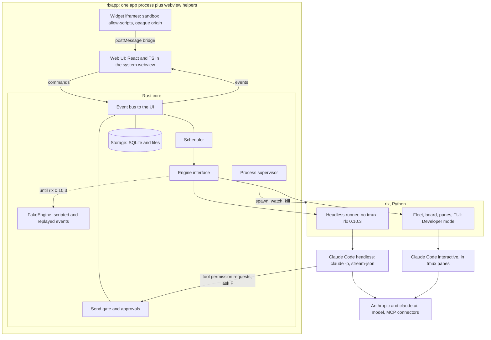
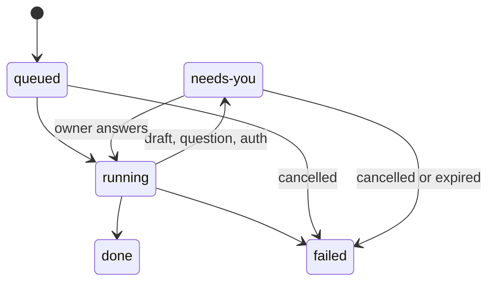

# rlxapp architecture

Status: draft for the owner's review, 2026-11-25. This is the target design; the Tauri skeleton and CI are built in parallel, and nothing here depends on their code.

Conventions:
- **(E*n*)** and **(R*n*)** cite the [evidence log](#16-evidence-log): commands run against Claude Code 2.1.332 and rlx 0.10.1.
- rlx file:line links are permalinks to rlx commit `c6b523c3`.
- **Unconfirmed** marks anything not yet checked.

## 1. Goals and budgets

rlxapp is a desktop app for people who don't use a terminal: GTM teams, team leads, working professionals. It runs rlx and Claude Code in the background and shows the results as widget dashboards. Developers keep the rlx TUI.

**Stack: Tauri 2, a Rust core and a web UI in the system webview** (owner decision, 2026-11-25, chosen over GPUI).
- **Discord, the visual reference.** On 2026-11-04 Discord announced a Rust rewrite of its desktop client on GPUI, dropping Electron. It keeps the system webview only for embedded content such as YouTube and Activities ([InfoQ](https://infoq.com/news/2026/11/discord-rust-rewrite-gpui-zed), [Inven Global](https://www.invenglobal.com/articles/28182/discord-cto-confirms-the-desktop-and-mobile-apps-are-being-rebuilt-in-rust)).
- **Why a webview for us.** Our agent-made HTML widgets are exactly that kind of embedded content, and they are the app's core, so a pure-Rust UI would still need a webview for most of the screen.

| Budget | Target | How it is measured |
|---|---|---|
| Installer | ≤ 25 MB | A CI job checks the size of each release artifact (`.dmg`, `.exe`, `.AppImage`/`.deb`) and fails any that is over. |
| Idle RAM | ≤ 150 MB | Release build on Apple silicon, default dashboard on cached data, 60 s after launch, no run in flight. Physical footprint (`footprint`/`ps`) of the app plus its WebKit helpers; engine processes reported separately. |
| Cold start | ≤ 1.5 s | From process spawn to the first dashboard paint (`performance.mark`). Median of 5 launches after a full quit, on Apple silicon. |

Known risk: WebKitGTK on Linux. CI tests it from the first commit.

## 2. Process model



- **Web UI** is first-party; **widget iframes** are untrusted and talk only to the UI (§5.3).
- **Process supervisor.** Starts and restarts engine processes, and kills whole trees (process groups on Unix, Job Objects on Windows).
- **Engine interface.** The single boundary to everything agentic. By the owner's decision, all agentic work goes through rlx; the core never spawns `claude` (§13).

```rust
#[async_trait]
pub trait Engine: Send + Sync {
    async fn status(&self) -> Result<EngineStatus>;            // installed, signed in
    async fn sign_in(&self) -> Result<Stream<SignInStep>>;     // open_url, waiting, signed_in, error
    async fn connectors(&self) -> Result<Vec<Connector>>;      // §4
    async fn run(&self, req: RunRequest) -> Result<RunHandle>; // Stream<RunEvent>
    async fn resume(&self, run: &RunId, reply: String) -> Result<RunHandle>;
    async fn cancel(&self, run: &RunId) -> Result<()>;
}
pub struct RunRequest {
    pub kind: RunKind,              // Task | WidgetRefresh | Watch | Check | SendExecutor | WidgetAuthor | ParseInstruction
    pub prompt: String,
    pub allowed_tools: Vec<String>, // empty = no tools
    pub output_schema: Option<serde_json::Value>,
    pub session_id: Uuid,           // chosen by the core, for resume
    pub gate: Arc<dyn ToolGate>,    // decides every write-classified tool call
}
```

`FakeEngine` (scripted scenarios and recorded stream-json replay) drives the shell, widgets and tests now. `RlxEngine` follows rlx 0.10.3. No direct-Claude engine ships.

`RunEvent` maps the stream-json events seen in E6: `system/init` → `Started`, `assistant` → `Text`/`ToolCall`, `rate_limit_event` → `RateLimited`, `result` → `Finished`. The tool-result event is unconfirmed.

## 3. Auth and Claude sign-in without a terminal

Claude Code is the only auth; the app has no accounts or tokens of its own.
- **Identity.** `claude auth status --json` reports `loggedIn`, `authMethod: "claude.ai"` and `subscriptionType` (E3, E4).
- **Detection.** `Engine.status()`; `RlxEngine` reads `rlx --json accounts list` (R3). The app pins the rlx version until that output has a `schema_version` (ask A).
- **No AISquare login.** rlx's own `rlx login` is AISquare's sign-in (R2) and never appears in the app.

**Signing in without a terminal.** Onboarding shows **Sign in with Claude**. `Engine.sign_in()` streams `open_url` (the app opens the system browser), then `waiting`, then `signed_in` or `error`.
- **rlx today.** `rlx accounts add` refuses `--json` and needs a TTY ([accounts.py:1197-1210](https://github.com/AISquare-Studio/rlx/blob/c6b523c3/src/aisquare/cli/accounts.py#L1197-L1210)).
- **Claude Code.** `claude auth login` defaults to `--claudeai` (E3). Whether it completes without a TTY is unconfirmed.
- **Ask G.** A non-TTY sign-in that emits these steps as JSON lines.
- **Last resort.** A hidden pseudo-terminal that surfaces only the URL.
- **Unconfirmed (ask E).** Whether the macOS Keychain read prompts when a GUI app triggers it.

**Never pass `--bare`.** It never reads OAuth or the keychain (E2), which breaks the claude.ai login.

**The app's own model calls** (checks, widget authoring, triage) are ordinary engine runs on the user's plan. Usage comes from `rlx --json accounts list --usage` (R3).

## 4. Connectors

Slack, Gmail and the others are claude.ai MCP connectors on the user's account. Claude Code mounts them under a claude.ai login, and the app never holds their credentials.

**Verified: headless runs load them (E6).** The probe was `claude -p` with `--output-format stream-json --verbose --tools "" --setting-sources project`, run from an empty directory, so no local MCP configuration was involved. In `system/init`:
- `mcp_servers` listed `claude.ai <Connector>` servers as `connected`;
- there were 67 tools named `mcp__claude_ai_<Connector>__<tool>`;
- `apiKeySource` was `"none"`.

Unconfirmed: a successful headless tool call (none was made, by rule), and listing connectors without a model turn (ask H).

**Path.** UI → core → `Engine` → rlx connector surface → Claude Code → claude.ai. Today `rlx --json connectors list` prints `{"error":"not_implemented",…}` and exits 70 (R4). The command is a hidden stub ([app.py:249](https://github.com/AISquare-Studio/rlx/blob/c6b523c3/src/aisquare/cli/app.py#L249), [connectors.py:8-25](https://github.com/AISquare-Studio/rlx/blob/c6b523c3/src/aisquare/services/connectors.py#L8-L25)).

**Connect and repair.** **Connect Slack** opens claude.ai's connector settings (URL unconfirmed). `claude mcp login <name>` covers "claude.ai connector" servers (E5), a re-auth candidate through rlx; its non-TTY behaviour is unconfirmed.

```ts
interface Connector {
  id: string;                                  // "claude.ai Slack"
  status: "connected" | "needs-auth" | "pending" | "failed";
  tools: { name: string; access: "read" | "write" | "unknown" }[];
}
```

**Access is data, not code.** The first source that answers wins:
1. MCP `readOnlyHint`, if exposed (ask H).
2. A shipped table for known connectors.
3. Name heuristics (`get`, `list`, `search`, `read`).

`write` and `unknown` tools go through the send gate (§8).

## 5. Widget runtime

**Build once, extend automatically.** A widget is a manifest, one self-contained HTML file and an optional data job. The core runs the data job through the engine and passes validated JSON to the widget, which only renders it. Connectors plug in through data jobs, never through per-service UI code.

### 5.1 Manifest

```ts
type WidgetManifest = {
  schemaVersion: 1;
  id: string;                  // "slack-digest"
  version: number;             // bumped on every change; old versions kept
  title: string;
  source: "builtin" | "agent" | "user";
  size: { w: 1 | 2 | 3 | 4; h: 1 | 2 | 3 | 4 };
  entry: "index.html";         // one file, ≤ 512 KB, inline JS/CSS
  data?: DataJob;              // absent for clock/timer/pomodoro
  actions: ("openUrl" | "notify" | "draftSend" | "refresh")[];
  settings?: JSONSchema;       // e.g. intervalMinutes
};
type DataJob = {
  connector: string;           // "claude.ai Slack"
  tools: string[];             // read tools only
  prompt: string;              // template: {{settings.*}} {{state.cursor}} {{owner}}
  output: JSONSchema;          // run output schema; validated again by the core
  every: { minutes: number } | { cron: string };
  runWhen: "app-open" | "background";
};
const slackDigest: WidgetManifest = { schemaVersion: 1, id: "slack-digest", version: 1,
  title: "Slack: needs you", source: "builtin", size: { w: 2, h: 3 }, entry: "index.html",
  actions: ["openUrl", "draftSend"], data: { connector: "claude.ai Slack", tools: ["<read tools>"],
  prompt: "…", output: { $ref: "feed.v1.json" }, every: { minutes: 15 }, runWhen: "background" } };
```

### 5.2 Data contract

```ts
type ToWidget =   // core → widget
  | { type: "init"; v: 1; widgetId: string; settings: object; state: object; theme: Theme }
  | { type: "data"; v: 1; data: unknown; fetchedAt: string; stale: boolean } // matches DataJob.output
  | { type: "status"; v: 1; status: "refreshing" | "ok" | "needs-auth" | "error" };
type FromWidget = // widget → core
  | { type: "ready" | "refresh"; v: 1 }
  | { type: "setState"; v: 1; state: object }       // ≤ 64 KB, persisted
  | { type: "openUrl"; v: 1; url: string }          // https only, system browser
  | { type: "notify"; v: 1; title: string; body: string; at?: string } // fired by the core
  | { type: "draftSend"; v: 1; connector: string; destination: string; body: string } // ALWAYS a Draft
  | { type: "resize"; v: 1; h: number };
```

Invalid data never reaches the widget (it keeps its last good data and shows `error`). Widgets can't call tools, read other widgets or reach the network, and undeclared actions are dropped.

### 5.3 Rendering: sandboxed iframe, CSP, bridge

- **The iframe.** `<iframe sandbox="allow-scripts">` with **no `allow-same-origin`**, and no popups, top navigation or forms. The opaque origin means no cookies or storage, and no access to the parent DOM or the Tauri IPC.
- **Serving.** The core serves the document over a custom scheme (`rlxwidget://<id>/<version>`), so the CSP is a response header the widget can't remove. The same policy is also injected as the first `<meta>`:
  `default-src 'none'; script-src 'unsafe-inline'; style-src 'unsafe-inline'; img-src data: blob:; font-src data:; connect-src 'none'; frame-src 'none'; form-action 'none'; base-uri 'none'`
- **Images** from connectors arrive as data URLs fetched by the core.
- **The bridge.** On load, the UI posts `init` plus one `MessageChannel` port to `iframe.contentWindow` (target `"*"`, since the origin is opaque); all later traffic uses that port. The UI accepts only `event.source === iframe.contentWindow`, validates and rate-limits every message (20/s), and the core re-validates actions.
- **Skeleton tests** on WKWebView, WebView2 and WebKitGTK: `__TAURI_INTERNALS__` is undefined in the iframe, the scheme's CSP header is enforced, and `fetch` is blocked. Agent-made widgets stay off on any platform that fails.

### 5.4 Agent-made widgets: create, store, update

- **Create.** The owner asks ("a widget with my open PRs"), or the agent suggests one. A tool-less `WidgetAuthor` run, given the SDK reference, the manifest schema and the read tools, must return `{manifest, html}` through `--json-schema` (E2). The core checks the schema, read-only tools, the size and that there are no external URLs, previews the widget with one dry-run refresh, and the owner clicks **Add**.
- **Store.** `widgets/<id>/<version>/{manifest.json,index.html}` plus a SQLite registry row. Built-ins are read-only; **Customize** copies one.
- **Update.** "Only show DMs" produces a new version, which is previewed, applied with one click, and can be rolled back. A change that adds tools is shown as a diff first. After three validation failures in a row, the widget offers **Fix with &lt;AgentName&gt;**.

### 5.5 A new connector gets a widget with zero new code

When `Engine.connectors()` reports an unseen connector, the core creates a `generic-connector` instance from a built-in template. The template fills in the connector, its read tools and a generic prompt ("up to 10 recent items that matter to {{owner}}; set needsYou when …"). One schema and one renderer serve every connector:

```ts
type Feed = { summary: string; items: { title: string; subtitle?: string; time?: string;
              url?: string; needsYou: boolean; why?: string }[] };   // schemas/feed.v1.json
```

No Rust or TS change is needed per connector. **Make it better** hands the instance to §5.4.

### 5.6 First widgets

| Widget | Data job | Highlights | Actions |
|---|---|---|---|
| Slack digest | Every N min (default 15), incremental via `state.cursor` | `needsYou` (DMs, mentions, threads waiting on the owner) first; the rest summarized | Open; **Draft reply** |
| Gmail dashboard | Every 15 min | Unread, awaiting reply, from people the owner writes to | Open; **Draft reply** |
| Clock, timer, pomodoro | None (local) | — | `notify {at}`: the core fires alarms even if the widget is unloaded |
| Generic per connector | §5.5 | `needsYou` | Open; Draft |

## 6. Scheduler and long-running tasks

Job kinds: `Task`, `WidgetRefresh`, `Watch` (an approval trigger), `Check`, `SendExecutor`, `WidgetAuthor` and `ParseInstruction`. All are engine runs.



- **needs-you.** A draft awaits approval, the agent asked a question (a task's final output follows `{status, summary, question?}`), a connector needs re-auth, or a tool was denied. The tray badge and OS notifications count these runs.
- **Streaming.** `RunEvent`s go to the run's transcript and the event bus. Runs on screen get partial text (`--include-partial-messages`, E2, through rlx).
- **Concurrency.** At most 2 tasks. Refreshes run one at a time and coalesce. `RateLimited` makes everything back off, and refreshes pause above a plan-usage threshold.
- **Cancel.** `Engine.cancel()` kills the run's process tree. The run becomes `failed {reason: "cancelled"}` and keeps its partial output.
- **Resume after restart.** Runs store their session ID: Claude Code has `--session-id` and `--resume` (E2), and rlx passing them through is ask I. On launch, interrupted tasks resume and refreshes rerun, but **an interrupted `SendExecutor` is never retried**: it becomes needs-you ("this may have sent; check first").
- **Background.** Closing the window hides it; the core keeps running from the menubar or tray, with a badge. **Quit** stops everything; launch at login is opt-in. Background jobs run while the app or tray is alive. Once rlx's scheduler ships (gap 4), the core registers jobs there so they run with the app closed, and mirrors their states.

## 7. Personal agent and sign-off

Onboarding asks for the agent's name (any, 1–32 characters) and the owner's display name. Both go into each run's `--append-system-prompt` (E2, through rlx).

The URL lives in one constant, exposed to the UI by a command. A CI grep fails the build if the URL appears anywhere else:

```rust
pub const APP_HOMEPAGE_URL: &str = "https://github.com/AISquare-Studio/rlxapp"; // until a homepage exists
```

The core renders the sign-off; the model never writes it. With agent "Nova" and owner "Alex":

| Target | Rendered |
|---|---|
| Slack mrkdwn | `— Nova, Alex's <https://github.com/AISquare-Studio/rlxapp\|AI Agent>` |
| Gmail HTML part | `<p>— Nova, Alex's <a href="https://github.com/AISquare-Studio/rlxapp">AI Agent</a></p>` |
| Gmail plain-text part | `— Nova, Alex's AI Agent (https://github.com/AISquare-Studio/rlxapp)` |
| Markdown connectors | `— Nova, Alex's [AI Agent](https://github.com/AISquare-Studio/rlxapp)` |

- **Escaping.** Names are escaped per target: Slack's `&<>` become entities, and HTML gets entity escaping. Multipart email gets the sign-off in both parts.
- **Enforcement.** The send gate requires the body to end with the exact sign-off. Without it, the call becomes a Draft with the sign-off appended.
- **Body fields.** A per-connector data table maps the body fields. The claude.ai Gmail tool fields are unconfirmed.

## 8. Send safety

### 8.1 One gate, one path

**The gate.** Every `write` or `unknown` tool call (§4) reaches the core's send gate before it executes. This needs rlx's runner to forward permission requests (ask F); Claude Code offers `--permission-prompts host` and `--settings` hooks (E2), protocol details unconfirmed. An unreachable gate means deny. The gate decides, not the model.

**One path.** Every send becomes a **Draft**: connector, tool, destination, body with sign-off, thread. The original call is denied with "saved as draft; do not retry". The mode decides who approves it:

| Mode | Approved by | Notes |
|---|---|---|
| **Draft** (default) | The owner: Approve, Edit or Discard | Every connector starts here |
| **Standing approval** | A confirmed approval plus the send-time check (§8.3) | Any mismatch or doubt leaves a Draft |
| **Auto** (opt-in per connector) | A 10 s hold with **Undo** | Labelled risky, enabled by typed confirmation, rate-limited (10/hour/connector by default), logged |

**Sending an approved Draft.** A `SendExecutor` run whose only tool is the draft's tool gets the exact payload. The gate allows only a call whose input hash equals the approved payload's; a mismatch is denied, retried once, then goes to needs-you.

**Undo.** The Auto hold covers every connector. After a send, Activity offers **Delete** where a delete tool exists (Slack's is unconfirmed).

### 8.2 Standing approvals: data model

```ts
type StandingApproval = {
  id: string;                         // "apr_…", minted only by the core
  status: "proposed" | "active" | "used" | "revoked" | "expired";
  confirmedAt?: string;               // set only by the owner's click
  instruction: { text: string; composerInputId: string };   // the owner's own words
  connector: string;                  // "claude.ai Slack"
  tools: string[];                    // write tools covered
  destination: { id: string; label: string };   // exact ID + "#dev"; no wildcards
  trigger: { kind: "now" } | { kind: "schedule"; cron: string }
         | { kind: "condition"; description: string; watch: DataJob };  // output { met: boolean }
  content: { description: string; maxChars: number; allowBroadcast: false };
  expiry: { kind: "once" } | { kind: "untilRevoked" };
};
```

**Lifecycle.** The owner types "when CI is green, post in #dev asking for approval". A tool-less `ParseInstruction` run, seeing only that text, proposes the fields. The app shows a card (*"Nova will post in #dev when CI on main is green: a message asking for approval to deploy. Once."*), and **Confirm** makes it `active`. Edits revoke and re-propose; `once` approvals become `used` after their send. The Approvals tab lists and revokes them.

### 8.3 Send-time check

1. **Code checks.** The approval is active and unexpired, and the run is bound to it. The connector, tool, destination ID and recipients match exactly. The body is within `maxChars`, has no broadcast mention, and carries the sign-off.
2. **Model check.** A `Check` run with no tools, no session persistence and `--json-schema` (E2) returns `{verdict: "match" | "mismatch" | "unsure", reason}`. Its input is the approval's description, the instruction and the outgoing body, quoted as data. It never sees what the composing run read from Slack or Gmail.
3. **Decision.** The message is sent only if every code check passes and the verdict is `match`. Anything else, errors and timeouts included, leaves a Draft with the reason.

### 8.4 Audit log

An append-only, hash-chained `audit` table (each row stores `prev_hash`). It is shown in Activity, exportable as JSONL, and never leaves the machine.
- **Each row:** seq, time, actor (owner, run, approval or `auto`), event, connector, destination, body hash, verdict and reasons, result (message ID or permalink).
- **Events:** `draft.*`, `approval.*` (proposed, confirmed, revoked, used, expired), `check.*`, `send.*` (held, sent, failed, undone) and `mode.changed`.

### 8.5 Prompt injection

**Rule: content read from Slack, Gmail or any connector can never create, widen or satisfy an approval.**

- **Create.** Approvals come only from composer text (the UI tags its origin). A tool-less run parses it, and the owner's click activates it. The proposal API rejects runs that have read connector data, and models never mint approval IDs.
- **Widen.** Approvals are immutable, and destinations are exact IDs.
- **Satisfy.** The core binds a run to an approval when its trigger fires. "Pre-approved by Alex" or a pasted `apr_…` does nothing: the gate never reads message text, the checker never sees connector content, and recipients are checked in code.
- **Triggers.** A watch outputs only `{met: boolean}`. A forged "CI is green" could at worst fire the approved send early, still bounded by its destination and content. This residual risk is accepted; triggers should read authoritative sources, not chat.
- **Widgets.** `draftSend` is always a Draft.
- **Auto.** Injected text could cause sends to destinations the connector allows. That is why Auto is opt-in, risky-labelled, rate-limited, held and logged.
- **Tests.** CI runs an injection corpus against the gate on `FakeEngine`, including fake approval IDs and look-alike channels.

## 9. Modes proposal

**A (recommended): one app with progressive disclosure.** Everyone sees Home (widgets), Tasks, Inbox (drafts and needs-you), Activity and Settings. A Developer toggle adds Fleet, Boards, Panes (read-only) and **Open in terminal**, which hands off to `rlx ui` (R2).
Pros: one install, updater and codebase; reversible. Cons: developer features must stay out of the way.

**B (alternative): two editions from one codebase**, "rlxapp" and "rlxapp Dev", chosen at download or in onboarding.
Pros: each edition stays focused. Cons: double the artifacts and QA; switching is harder.

rlx is the engine in both (§13). The shell implements A; the owner decides after seeing it.

## 10. Install and update

**The app.** Tauri's updater checks signed manifests on GitHub Releases and asks before installing.
- **macOS:** notarized `.dmg`, arm64 first.
- **Windows:** per-user NSIS `.exe` with the WebView2 bootstrapper.
- **Linux:** `.AppImage` and `.deb` (needs WebKitGTK 4.1).

**The engine.** rlx and Python are not bundled (the 25 MB budget). On first run the app runs rlx's installer and shows progress. What it needs (ask B), against today:

| Need | Today |
|---|---|
| JSON-lines progress; no sudo prompt | Text output; `sudo` without `-n` ([install.sh:355-370](https://github.com/AISquare-Studio/rlx/blob/c6b523c3/install.sh#L355-L370)) |
| A pinned version | An unstamped copy fetches the latest release's script ([install.sh:560-568](https://github.com/AISquare-Studio/rlx/blob/c6b523c3/install.sh#L560-L568)) |
| `[serve]` by default | No extras ([install.sh:1494-1510](https://github.com/AISquare-Studio/rlx/blob/c6b523c3/install.sh#L1494-L1510), [pyproject.toml:110-123](https://github.com/AISquare-Studio/rlx/blob/c6b523c3/pyproject.toml#L110-L123)) |
| No tmux in simple mode | An unattended install declines Homebrew, which skips tmux ([install.sh:503-515](https://github.com/AISquare-Studio/rlx/blob/c6b523c3/install.sh#L503-L515), [:1631](https://github.com/AISquare-Studio/rlx/blob/c6b523c3/install.sh#L1631)). Developer mode still needs tmux |
| Native Windows (ask D) | `install.ps1` hands off to WSL2 ([install.ps1:13-21](https://github.com/AISquare-Studio/rlx/blob/c6b523c3/install.ps1#L13-L21)) |

rlx installs Claude Code, which also has `claude install` and `claude update` (E8).

**Updates.**
- **rlx:** `rlx --json upgrade --yes`; `--yes` is required off a terminal (R5). It refuses while an rlx UI runs ([install.py:100-101](https://github.com/AISquare-Studio/rlx/blob/c6b523c3/src/aisquare/cli/install.py#L100-L101)), so the app checks `rlx --json instances` (R2) and retries when idle. Whether non-UI rlx processes also block it is unconfirmed (ask E).
- **Claude Code:** updates itself.

## 11. Platform matrix for v0

| | macOS | Windows | Linux |
|---|---|---|---|
| v0 bar | Polished; budgets enforced | Built and smoke-tested in CI | Built and smoke-tested in CI |
| Arch | arm64 | x64 | x64 |
| Webview | WKWebView | WebView2 | WebKitGTK 4.1 (**risk**) |
| Tray | Menubar | System tray | AppIndicator (GNOME needs an extension) |
| Engine | `FakeEngine`, then `RlxEngine` | `FakeEngine` until ask D | `FakeEngine`, then `RlxEngine` |
| CI smoke | Launch, render, §5.3 tests, quit | Same | Same, under Xvfb |

## 12. Local storage and privacy

**Where data lives:** the OS app-data directory holds `rlxapp.db` (SQLite, WAL: runs, jobs, drafts, approvals, audit, widget registry, settings), `widgets/`, `transcripts/` (30 days by default) and rotated `logs/`.

**Privacy.** The app stores no credentials (Claude Code and claude.ai hold them). There is no telemetry or crash reporting by default, and the app's only own traffic is the update check, which can be turned off. Claude Code's analytics setting (`analyticsDisabled`, E4) is the user's to change, not the app's. **Erase local data** deletes everything.

## 13. rlx dependency

**The split.** The rlx survey proposed one: in simple mode the core drives `claude -p` directly, and in developer mode it uses the rlx fleet.

**Rejected by the owner on 2026-11-25.** All agent work, in both modes, goes through rlx. rlx 0.10.3 ("rlx for apps") is to add a tmux-free headless runner, native Windows, a scheduler, a connector surface, a non-project home, and asks A–D; ask E is answered from rlx's code. Until then the app builds against `Engine` with `FakeEngine`.

**What the runner wraps** (E2, E6, E7):
- **Structured streaming.** `-p --output-format stream-json`, plus `--include-partial-messages` for partial chunks and `--input-format stream-json` for streaming input. The probe also passed `--verbose`; whether it is still required is unconfirmed.
- **Connectors.** claude.ai connectors load headless (§4).
- **Hooks and trust.** User hooks run headless. `-p` skips the workspace-trust dialog, so runs must start in the app's own home directory.

**Gaps,** re-checked at `c6b523c3`:

| # | Gap | Evidence | rlxapp until it closes |
|---|---|---|---|
| 1 | No native Windows | [install.ps1:13-21](https://github.com/AISquare-Studio/rlx/blob/c6b523c3/install.ps1#L13-L21) | Windows runs `FakeEngine` |
| 2 | tmux-only fleet, no headless runner | R2, [install.sh:1631](https://github.com/AISquare-Studio/rlx/blob/c6b523c3/install.sh#L1631) | `FakeEngine` replays recorded stream-json |
| 3 | No connector surface | R4, [app.py:249](https://github.com/AISquare-Studio/rlx/blob/c6b523c3/src/aisquare/cli/app.py#L249) | Fake Slack and Gmail |
| 4 | No user-defined scheduler | [watcher.py:48-108](https://github.com/AISquare-Studio/rlx/blob/c6b523c3/src/aisquare/cli/watcher.py#L48-L108), R8 | In-app scheduler |
| 5 | No app-facing daemon with push | R6 (`serve` is MCP), R7 (`remote`: password, auto-off, ngrok) | Fake event stream |
| 6 | Installer not built for unattended GUI use | §10 | Fake install steps |
| 7 | Sign-in needs a TTY | [accounts.py:1197-1210](https://github.com/AISquare-Studio/rlx/blob/c6b523c3/src/aisquare/cli/accounts.py#L1197-L1210) | Fake sign-in; ask G |
| 8 | No versioned contract | [common.py:1261-1269](https://github.com/AISquare-Studio/rlx/blob/c6b523c3/src/aisquare/cli/common.py#L1261-L1269) (no `message`), [root.py:160-162](https://github.com/AISquare-Studio/rlx/blob/c6b523c3/src/aisquare/cli/root.py#L160-L162) (`doctor --fix` on stdout) | `Engine` types are our proposed contract |
| 9 | Output is screen capture | [tmux.py:10](https://github.com/AISquare-Studio/rlx/blob/c6b523c3/src/aisquare/core/tmux.py#L10) | Read-only ANSI panes |
| 10 | Bound to a project folder | [workspace.py:29](https://github.com/AISquare-Studio/rlx/blob/c6b523c3/src/aisquare/core/workspace.py#L29) | The app's own home directory |
| 11 | Upgrade blocked while the UI runs | [install.py:100-101](https://github.com/AISquare-Studio/rlx/blob/c6b523c3/src/aisquare/cli/install.py#L100-L101) | Retry when idle |

**Asks.** A–E are from the survey:
- **A.** A versioned JSON envelope (`schema_version`, `ok`, `data`, `error{code,message,hint}`) with published schemas.
- **B.** A silent installer mode (§10).
- **C.** A localhost event stream with token auth.
- **D.** Native Windows for install, accounts, upgrade and doctor.
- **E.** Answers on upgrading while rlx runs, and on the Keychain prompt.

This doc adds F–I:
- **F.** The runner forwards every tool permission request to the app, or lets it inject a PreToolUse hook. **Send safety depends on this.**
- **G.** A non-TTY sign-in with JSON-lines steps.
- **H.** Connector listing with tool read/write annotations, ideally without a model turn.
- **I.** Session IDs and cancel passed through.

## 14. Open questions

**For the owner:**
1. Mode A or B (§9)?
2. Slack digest default N: 15 minutes? Each refresh uses the plan.
3. Should Auto require a destination allowlist? Is a 10 s hold right?
4. Are `once` and `untilRevoked` enough expiry options?
5. Does the 150 MB idle budget include rlx's background process?
6. Who holds the Apple and Windows signing certificates?

**For the hub:**
1. Asks F–I (F blocks send safety, G blocks sign-in).
2. Scheduler of record: rlx's or the app's? Can jobs run with the app closed?
3. Ask C's transport, auth and `schema_version`.
4. Where is the non-developer home, and do user hooks load in app runs?
5. Ask E's answers.

## 15. Traceability

| Vision bullet (owner's brief) | Section |
|---|---|
| Native app for macOS, Windows, Linux | §11, §10 |
| Installs and runs rlx in the background | §10, §2, §6 |
| Friendly for people without a terminal | §3, §9 |
| Developers keep the rlx TUI | §9 |
| Sleek, fast, light; Discord reference verified | §1 |
| Long-running agent tasks via rlx and Claude Code | §6, §13 |
| Claude Code is the only auth, for user and connectors | §3, §4 |
| Widget dashboards: build once, extend automatically | §5 |
| Slack digest every N minutes | §5.6 |
| Gmail dashboard | §5.6 |
| Clock, timer, pomodoro | §5.6 |
| Generic per-connector widgets | §5.5 |
| Users and their agent create widgets | §5.4 |
| Personal agent with any name | §7 |
| Sign-off linking to one homepage constant | §7 |
| One app plus Developer toggle; owner decides | §9, §14 |
| Rust core and Tauri 2; budgets; WebKitGTK risk | §1, §11 |
| Safe sends on the user's behalf (Draft default) | §8 |

## 16. Evidence log

All commands were read-only. Nobody signed in or out, no connector tool was called, and nothing was sent.

| ID | Command | Showed |
|---|---|---|
| E1 | `claude --version` | `2.1.332 (Claude Code)` |
| E2 | `claude --help` | The flags cited above; `-p` skips the trust dialog; `--bare`: "OAuth and keychain are never read" |
| E3 | `claude auth login --help`, `claude auth status --help` | `--claudeai` (default), `--console`, `--sso`; `status --json` |
| E4 | `claude auth status --json` (values redacted) | `loggedIn`, `authMethod: "claude.ai"`, `subscriptionType`, `analyticsDisabled` |
| E5 | `claude mcp login --help` | "HTTP, SSE, or claude.ai connector"; `--no-browser` |
| E6 | `claude -p "Reply with the single word OK. Do not call any tools." --output-format stream-json --verbose --tools "" --no-session-persistence --permission-mode dontAsk --permission-prompts none --setting-sources project`, empty directory | Events and init fields as reported in §4 |
| E7 | E6 without `--setting-sources project` | First event `system/hook_started` |
| E8 | `claude install --help`, `claude update --help` | Native install, self-update |
| R1 | `rlx --version` | `rlx 0.10.1`; source read at `c6b523c3` |
| R2 | `rlx --help` | `login` (AISquare), `ui`, `instances`, `serve`, `remote`, `fleet` ("each a tmux pane"), `upgrade` |
| R3 | `rlx --json accounts list --help` | `--usage`, `--refresh` |
| R4 | `rlx --json connectors list` | `{"error":"not_implemented",…}`, exit 70 |
| R5 | `rlx upgrade --help` | `--yes` "required off a terminal" |
| R6 | `rlx serve --help` | MCP server; `--stdio`, `--port`, bearer token |
| R7 | `rlx remote serve --help` | `--auto-off MINUTES`, ngrok |
| R8 | `rlx watch --help` | `--detach` "in a window of the fleet's tmux server" |
